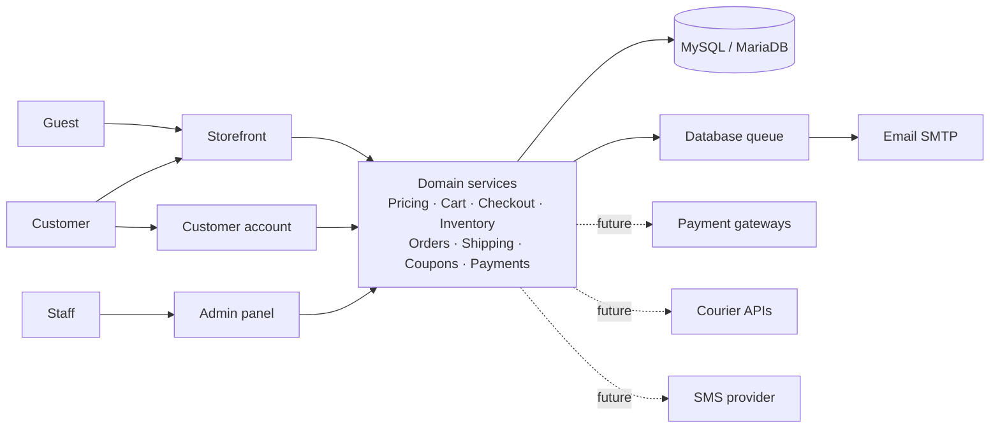
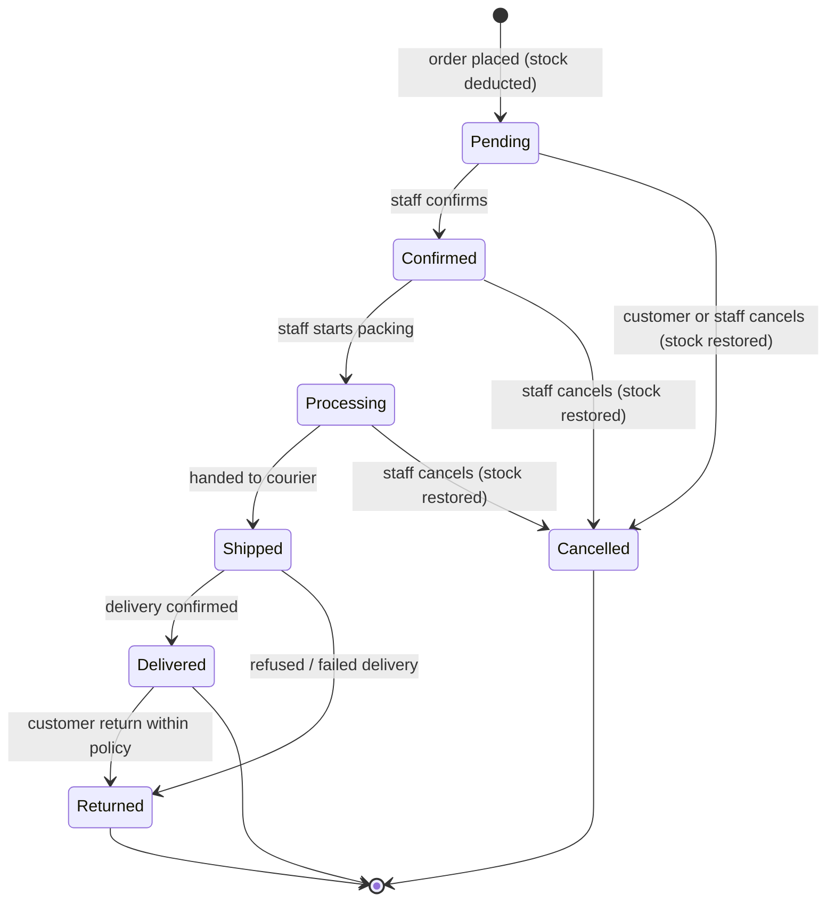

# DOC-02 — Software Requirements Specification (SRS)

| Field | Value |
|---|---|
| Project | Modern E-Commerce Website (Bangladesh) — working name **[Store Name]** |
| Document ID | DOC-02 |
| Version | 0.2 (Draft) |
| Date | 2026-10-13 |
| Prepared by | Claude (acting Senior BA / Solution Architect) |
| Approver | [Product Owner — to be named] |
| Depends on | DOC-01 BRD v0.2 |
| Status | Draft — awaiting review |

---

## 1. Introduction

### 1.1 Purpose
This SRS defines what the MVP system must do (functional requirements) and how well it must do it (non-functional requirements). It is the baseline for design (DOC-04 to DOC-06), testing (DOC-08) and traceability (DOC-11).

### 1.2 Conventions

- **Requirement IDs**: `FR-<MODULE>-<NNN>` for functional, `NFR-<AREA>-<NN>` for non-functional, `VR-<NN>` for validation rules, `AC-<MODULE>-<NN>` for acceptance criteria.
- **Priority** (MoSCoW): **M** Must (MVP), **S** Should (MVP if time allows, otherwise next release), **C** Could (later), **F** Future scope — design for, do not build.
- **Trace** column links to BRD objectives (BO) and business rules (BR).
- "Staff" means an authenticated admin-panel user; "customer" means a registered storefront user; "guest" means an unauthenticated visitor.

### 1.3 Module codes

| Code | Module | Code | Module |
|---|---|---|---|
| CAT | Catalogue (categories, products, variants, images) | PRM | Coupons & promotions |
| SRC | Search, filter, sort | SHP | Delivery zones & charges |
| STF | Storefront pages & content | PAY | Payment methods |
| CRT | Cart | REV | Reviews |
| CHK | Checkout | WSH | Wishlist |
| ORD | Orders | ADM | Admin users, roles, permissions |
| INV | Inventory | RPT | Reports & dashboard |
| ACC | Customer account | SET | Site settings & SEO |
| NTF | Notifications | AUD | Audit trail |

## 2. System overview

A server-rendered Laravel monolith with two areas sharing one database:

- **Storefront** (public + customer account) — Blade views, Tailwind CSS, Alpine.js for small interactions (gallery, variant picker, cart drawer, quantity stepper, filters on mobile).
- **Admin panel** (`/admin`, separate authentication guard) — Blade views, role/permission-based access.

Domain logic (pricing, cart, checkout, inventory, order status, shipping, coupons, payments) lives in service classes so controllers stay thin and logic is testable. Payment methods are implemented behind a common interface; only Cash on Delivery is active in MVP. Background jobs (emails, sitemap) use Laravel's database queue triggered by cron, which suits shared cPanel hosting. Full architecture is defined in DOC-05.



## 3. User classes

| Class | Description | Access |
|---|---|---|
| Guest | Unauthenticated visitor | Browse, search, cart, guest checkout, track order (order no. + phone) |
| Customer | Registered and logged-in user | Guest abilities + account, addresses, order history, wishlist, reviews |
| Staff | Admin panel user with one or more roles | As granted by permissions (§4) |

## 4. Roles and permissions

Staff permissions are granular (e.g. `products.view`, `products.edit`, `orders.update-status`). Roles are named bundles of permissions and are editable by a Super Admin. Proposed default roles:

| Permission group | Super Admin | Store Manager | Order Manager | Catalog Manager | Content Editor | Support |
|---|---|---|---|---|---|---|
| Dashboard & reports | Full | Full | Orders only | Inventory only | — | — |
| Products, categories, images, variants | Full | Full | View | Full | View | View |
| Prices & compare-at prices | Full | Full | — | Edit | — | — |
| Inventory adjustments | Full | Full | — | Full | — | — |
| Orders: view | Full | Full | Full | View | — | Full |
| Orders: change status, cancel | Full | Full | Full | — | — | — |
| Orders: returns & record payment/refund | Full | Full | Full | — | — | — |
| Customers | Full | Full | View | — | — | View |
| Coupons | Full | Full | — | — | Full | — |
| Banners, homepage, pages | Full | Full | — | — | Full | — |
| Delivery zones & payment settings | Full | Full | — | — | — | — |
| Review moderation | Full | Full | — | — | Full | View |
| Site & SEO settings | Full | Full | — | — | SEO only | — |
| Staff users, roles, permissions | Full | — | — | — | — | — |
| Audit trail | Full | View | — | — | — | — |

Rules: the last active Super Admin cannot be deactivated or demoted; staff cannot edit their own roles.

## 5. Functional requirements

### 5.1 Catalogue (CAT)

| ID | Requirement | Pri | Trace |
|---|---|---|---|
| FR-CAT-001 | Staff can create, edit, reorder, activate/deactivate and delete categories with name, slug, parent (one level of subcategory minimum, two supported), description, image, meta title/description and sort order. | M | BO-06, BR-20 |
| FR-CAT-002 | A category with products or child categories cannot be deleted; it can be deactivated. | M | BO-06 |
| FR-CAT-003 | Staff can create and edit products with name, slug, short description, full description (sanitised rich text), category (primary) and optional additional categories, brand (optional), status (Draft / Active / Archived), featured flag, meta title/description. | M | BO-05 |
| FR-CAT-004 | Products have configurable option types (e.g. Colour, Size, Model) and values; option types are admin-managed, not hard-coded. | M | BO-06 |
| FR-CAT-005 | Each product has one or more variants. A variant has SKU (unique), optional barcode, option value combination, price, optional compare-at price, stock quantity, low-stock threshold, weight (optional), active flag. A product without options has one default variant. | M | BR-03 |
| FR-CAT-006 | Compare-at price must be greater than price to be displayed; otherwise it is ignored. | M | BR-17 |
| FR-CAT-007 | Staff can upload multiple images per product, set the main image, reorder images, add alt text, and optionally link an image to a variant (e.g. colour). | M | BO-01 |
| FR-CAT-008 | Uploaded images are validated (VR-10), stored outside executable paths, and resized into standard sizes (thumbnail, card, detail, zoom) in WebP with original-format fallback. | M | NFR-SEC, NFR-PERF |
| FR-CAT-009 | Staff can define specification attributes (label/value pairs, e.g. "Battery: 30 h") per product for the detail page. | M | BO-01 |
| FR-CAT-010 | Staff can mark products as related manually; if none are set, the system shows active products from the same category. | M | — |
| FR-CAT-011 | Products in Draft or Archived status, or with no active variants, are not visible on the storefront; direct URLs return 404 (Archived may show "no longer available" page — S). | M | — |
| FR-CAT-012 | Bulk product import/export via CSV. | C | — |

### 5.2 Search, filter and sort (SRC)

| ID | Requirement | Pri | Trace |
|---|---|---|---|
| FR-SRC-001 | Visitors can search products by name, SKU and short description from the header on every page. | M | BO-01 |
| FR-SRC-002 | Listing pages (category, search, "shop all", new arrivals, deals) support filters: category/subcategory, price range, in-stock only, option values (e.g. colour), brand where used. | M | BO-01 |
| FR-SRC-003 | Sorting: relevance (search only), newest, price low→high, price high→low, best selling. | M | — |
| FR-SRC-004 | Listings are paginated (default 24 per page, configurable); filter and sort state is kept in the URL so pages are shareable and crawlable. | M | — |
| FR-SRC-005 | Empty results show a helpful message and suggestions (clear filters, popular categories). | M | — |
| FR-SRC-006 | Search suggestions while typing (debounced, limited results). | S | — |

### 5.3 Storefront and content (STF)

| ID | Requirement | Pri | Trace |
|---|---|---|---|
| FR-STF-001 | Home page sections are admin-managed and orderable: hero banner(s), category grid, featured products, latest products, best sellers, promotional banner(s), trust badges, newsletter block. Each section can be enabled or disabled. | M | BO-06 |
| FR-STF-002 | Best sellers are calculated from delivered-and-not-returned order quantities over a configurable period (default 30 days); staff may pin products. | M | BR-17 |
| FR-STF-003 | Banners have image (desktop and mobile versions), title, subtitle, button label, link, schedule (start/end), sort order and active flag. | M | — |
| FR-STF-004 | Optional announcement bar with admin text and link (e.g. free-delivery threshold). | M | — |
| FR-STF-005 | Product detail page shows gallery, name, price, compare-at price and saving (only per FR-CAT-006), stock status, variant selectors, quantity selector, Add to cart, Buy now, delivery estimate text, policy assurances, description, specifications, approved reviews with average rating, related products. | M | BO-01 |
| FR-STF-006 | Selecting a variant updates price, stock status, SKU and image without a page reload; unavailable combinations are shown as disabled. | M | — |
| FR-STF-007 | Static pages (About, Contact, FAQ, Privacy, Terms, Return & Refund, Shipping) are editable by staff (title, slug, sanitised content, meta). | M | BO-06 |
| FR-STF-008 | Contact page shows business contact details from settings and a contact form (rate-limited, spam-protected with honeypot) that emails staff and stores the message. | M | — |
| FR-STF-009 | Newsletter sign-up stores email with consent timestamp; export to CSV. Sending campaigns is out of scope. | S | — |
| FR-STF-010 | No link, button or menu item may be present without a working destination; unbuilt features are hidden, not shown as dead controls. | M | — |

### 5.4 Cart (CRT)

| ID | Requirement | Pri | Trace |
|---|---|---|---|
| FR-CRT-001 | Guests and customers can add a variant with quantity to the cart, update quantity and remove items. | M | BO-02 |
| FR-CRT-002 | The cart is stored server-side: guests by a secure cart token cookie, customers by account. On login, the guest cart merges into the customer cart (quantities summed, capped by stock). | M | — |
| FR-CRT-003 | Quantity cannot exceed available stock or a configurable per-line maximum (default 10). | M | BR-04 |
| FR-CRT-004 | The cart always displays current server prices. If a price or stock changed since the item was added, the cart shows a notice on the affected line. | M | BR-02 |
| FR-CRT-005 | Inactive or out-of-stock items stay visible but are flagged and excluded from checkout until removed or back in stock. | M | — |
| FR-CRT-006 | A cart drawer/mini-cart shows item count and subtotal in the header. | M | BO-01 |
| FR-CRT-007 | Guest carts older than a configurable period (default 30 days) are purged by a scheduled job. | M | NFR-DATA |

### 5.5 Checkout (CHK)

| ID | Requirement | Pri | Trace |
|---|---|---|---|
| FR-CHK-001 | Checkout is available to guests and customers on a single page optimised for mobile. Registration is optional and can be offered after the order is placed. | M | BO-01 |
| FR-CHK-002 | Checkout collects: full name, mobile number, optional email, division, district, area/thana, street address, optional postcode, optional delivery instructions. Customers can select a saved address or add a new one. | M | BR-14 |
| FR-CHK-003 | Delivery zone and charge are determined from the selected district/area (FR-SHP-002) and shown before placing the order. | M | BR-13 |
| FR-CHK-004 | Customers can apply and remove one coupon; the result (accepted with discount amount, or reason for rejection) is shown immediately. | M | BR-12 |
| FR-CHK-005 | Order summary shows each line (name, variant, quantity, unit price, line total), subtotal, discount, delivery charge and grand total. | M | BO-02 |
| FR-CHK-006 | Customer selects a payment method from those enabled; MVP offers Cash on Delivery only. | M | BO-03 |
| FR-CHK-007 | On "Place order" the server re-reads prices, re-validates stock, coupon and delivery zone, recalculates every amount, and creates the order inside a single database transaction (FR-INV-003). If anything changed, the order is not placed and the customer sees the updated summary with an explanation. | M | BR-02, BR-04 |
| FR-CHK-008 | Duplicate submissions are prevented: each checkout form carries a one-time idempotency token; resubmitting the same token returns the already-created order instead of creating a new one. The button is also disabled while submitting. | M | BO-02 |
| FR-CHK-009 | A unique, non-sequential-looking order number is generated (format proposal: `[PREFIX]-YYMMDD-XXXXX`, e.g. `ST-261013-4K7Q2`). | M | — |
| FR-CHK-010 | After success, the customer sees a confirmation page with order number, summary, payment method, next steps ("we will call to confirm") and a tracking link. The confirmation page is only viewable by the order owner (customer session or signed guest link). | M | BR-19 |
| FR-CHK-011 | Configurable minimum order value and COD maximum order value. | S | — |
| FR-CHK-012 | Checkout and "Place order" are rate-limited per IP and per phone number to reduce fake orders. | M | R-03 |

### 5.6 Orders (ORD)

| ID | Requirement | Pri | Trace |
|---|---|---|---|
| FR-ORD-001 | An order stores a snapshot of customer, contact and address details, line items (product name, variant description, SKU, unit price, quantity, line total), coupon code and discount, delivery zone and charge, totals, payment method, and notes — so later catalogue changes do not alter past orders. | M | BO-02 |
| FR-ORD-002 | Order status follows the state machine in §6.3. Each change records old status, new status, staff user (or customer/system), time and optional note. | M | BR-10 |
| FR-ORD-003 | Payment status is separate: Unpaid, Paid, Partially Refunded, Refunded (and Failed / Pending for future gateways). | M | BR-11 |
| FR-ORD-004 | Staff can list, search (order number, phone, name), filter (status, payment status, date range, zone) and sort orders, and open order details with full history. | M | BO-05 |
| FR-ORD-005 | Staff can add internal notes (not visible to the customer) and record courier name and tracking reference as free text. | M | A-04 |
| FR-ORD-006 | Staff can edit an order's shipping address and contact details while it is Pending or Confirmed; changes are audited. Editing items after placement is out of MVP (cancel and re-create instead). | S | — |
| FR-ORD-007 | Staff can print an invoice/packing slip for an order. | M | A-06 |
| FR-ORD-008 | Customers can cancel their own Pending orders with a reason (BR-09). | M | BR-09 |
| FR-ORD-009 | Returns: staff can mark a Shipped order as Returned (refused/failed delivery) or a Delivered order as Returned (customer return within policy), recording reason and, per item, whether it is restocked or written off (BR-07). | M | BR-07 |
| FR-ORD-010 | Refunds are recorded manually (amount, method, reference, note) and update payment status; no automated refund in MVP. | M | FS-11 |
| FR-ORD-011 | Customers see a timeline of customer-facing statuses; internal notes are never shown. | M | — |
| FR-ORD-012 | Bulk status update for selected orders (only where each transition is valid). | S | — |

### 5.7 Inventory (INV)

| ID | Requirement | Pri | Trace |
|---|---|---|---|
| FR-INV-001 | Stock is tracked per variant as an integer that cannot be negative (enforced in application logic and by an unsigned column / check). | M | BR-04 |
| FR-INV-002 | Every stock change creates a stock movement record: variant, type (Opening, Purchase/Restock, Sale, Cancellation, Return-Restock, Return-Write-off, Manual Adjustment, Correction), signed quantity, resulting balance, reason, order reference, user, timestamp. | M | BR-08 |
| FR-INV-003 | Order placement locks the affected variant rows (`SELECT … FOR UPDATE`, in a consistent order to avoid deadlocks), verifies availability, deducts stock and writes movements in the same transaction as the order. If any line is short, the whole transaction rolls back. | M | BR-04, BR-05 |
| FR-INV-004 | Cancelling an unshipped order restores stock with Cancellation movements, exactly once per order (guarded against repeated cancellation). | M | BR-06 |
| FR-INV-005 | Staff with permission can adjust stock (increase or decrease) with a mandatory reason; decreases below zero are refused. | M | BR-08 |
| FR-INV-006 | Inventory screen lists variants with SKU, stock, threshold and status; filters for low stock and out of stock; movement history per variant. | M | BO-05 |
| FR-INV-007 | Low-stock email digest to inventory staff (daily, when any variant is at or below threshold). | S | — |

### 5.8 Customer account (ACC)

| ID | Requirement | Pri | Trace |
|---|---|---|---|
| FR-ACC-001 | Registration with name, mobile number, email and password. Mobile number and email are each unique among customers. | M | BR-14 |
| FR-ACC-002 | Login with email or mobile number plus password; "remember me" option. | M | — |
| FR-ACC-003 | Password reset by emailed, time-limited, single-use link. (SMS OTP reset is future scope, FS-03.) | M | — |
| FR-ACC-004 | Email verification is required before writing reviews; it is not required to place orders. | S | — |
| FR-ACC-005 | Profile: view and edit name, email, mobile, change password (requires current password). | M | — |
| FR-ACC-006 | Address book: add, edit, delete, set default; multiple addresses. | M | — |
| FR-ACC-007 | Order history with status, date, total; order detail with items, amounts, address, status timeline, and cancel option when allowed. | M | BR-19 |
| FR-ACC-008 | Guest order tracking page: order number + phone number shows the status timeline and summary (masked address). | M | BR-15 |
| FR-ACC-009 | Guest orders placed with a phone/email that later registers can be linked to the account after the customer verifies the email address used on the order. | C | — |
| FR-ACC-010 | Customer can log out of all other sessions after a password change. | S | NFR-SEC |
| FR-ACC-011 | Customer can request account deletion; personal data is anonymised while order records needed for accounting are kept. | S | NFR-DATA |

### 5.9 Wishlist (WSH) and Reviews (REV)

| ID | Requirement | Pri | Trace |
|---|---|---|---|
| FR-WSH-001 | Logged-in customers can add/remove products to a wishlist from cards and detail pages and view it in their account. Guests are prompted to log in and returned to the product afterwards. | M | A-08 |
| FR-WSH-002 | Wishlist shows current price and stock; move-to-cart action requires variant selection where needed. | M | — |
| FR-REV-001 | A customer can submit one review per product per delivered order line: rating 1–5, optional title and text. | M | BR-16 |
| FR-REV-002 | Reviews are Pending until a staff member approves or rejects them; rejected reviews are not shown. | M | BR-16 |
| FR-REV-003 | Product pages show approved reviews (paginated), average rating and count, with a "verified purchase" label. | M | BR-16 |
| FR-REV-004 | Staff may publish a public reply to a review. | S | — |
| FR-REV-005 | The system never seeds or generates reviews, ratings or sales counts; demo data has none. | M | BR-16, BR-17 |

### 5.10 Coupons and promotions (PRM)

| ID | Requirement | Pri | Trace |
|---|---|---|---|
| FR-PRM-001 | Staff can create coupons: code (case-insensitive, unique), type (percentage / fixed amount / free delivery), value, maximum discount cap (for percentage), minimum order subtotal, start and end date-time, total usage limit, per-customer limit (by account or phone number), active flag. | M | BR-12 |
| FR-PRM-002 | Optional applicability restriction to selected categories or products; the discount then applies only to eligible lines. | S | BR-12 |
| FR-PRM-003 | Coupon usage is counted when an order is placed and released if the order is cancelled before shipping. Usage limit checks happen inside the order transaction. | M | BR-12 |
| FR-PRM-004 | Coupon list shows usage count and total discount given. | M | — |
| FR-PRM-005 | Automatic promotions, bundles, "buy X get Y", flash sales. | F | FS-09 |

### 5.11 Delivery zones and charges (SHP)

| ID | Requirement | Pri | Trace |
|---|---|---|---|
| FR-SHP-001 | The system is seeded with Bangladesh's 8 divisions and 64 districts. Staff can add areas/thanas under districts. | M | BO-06 |
| FR-SHP-002 | Staff can create delivery zones (e.g. Inside Dhaka, Dhaka Suburbs, Outside Dhaka) and assign districts and/or specific areas to a zone. Area assignment overrides district assignment. Every district must resolve to exactly one zone. | M | BR-13 |
| FR-SHP-003 | Each zone has a base delivery charge, optional free-delivery threshold, estimated delivery text (e.g. "1–2 days"), and active flag. | M | BR-13 |
| FR-SHP-004 | Optional weight-based surcharge per zone (per additional kg above a base weight). | C | — |
| FR-SHP-005 | Global settings: whether delivery to unassigned areas is allowed (default: no — show "contact us"). | M | — |

### 5.12 Payment methods (PAY)

| ID | Requirement | Pri | Trace |
|---|---|---|---|
| FR-PAY-001 | Payment methods are implemented through a common interface (initiate, handle return/callback, verify, refund capability flags). | M | BO-03, BO-08 |
| FR-PAY-002 | Cash on Delivery is available in MVP; staff can enable/disable it, set display name, instructions, and optional maximum order value. | M | BO-03 |
| FR-PAY-003 | For COD, staff mark payment as collected (Paid) on or after delivery; the system records who and when. | M | BR-11 |
| FR-PAY-004 | Gateway methods (bKash, Nagad, SSLCommerz…) are listed in configuration as future and cannot be enabled until implemented and approved. | F | FS-01 |

### 5.13 Notifications (NTF)

| ID | Requirement | Pri | Trace |
|---|---|---|---|
| FR-NTF-001 | Order confirmation email to the customer when an email is provided. | M | — |
| FR-NTF-002 | New-order email to a configurable staff address. | M | — |
| FR-NTF-003 | Status-change emails to the customer (Confirmed, Shipped, Delivered, Cancelled) — individually switchable in settings. | S | — |
| FR-NTF-004 | Account emails: password reset, email verification. | M | — |
| FR-NTF-005 | All emails are queued (database queue) and retried on failure; failures are logged and do not block the order. | M | NFR-REL |
| FR-NTF-006 | SMS notifications through a pluggable channel. | F | FS-03 |

### 5.14 Admin users, roles and permissions (ADM)

| ID | Requirement | Pri | Trace |
|---|---|---|---|
| FR-ADM-001 | Staff authenticate on a separate admin login (`/admin/login`) with their own account table and guard, distinct from customer accounts. | M | NFR-SEC |
| FR-ADM-002 | Super Admin can create, edit, deactivate staff, assign roles, and create/edit roles from a permission list (§4). | M | BR-18 |
| FR-ADM-003 | Every admin route and action checks permissions on the server; menu items the user cannot use are hidden. | M | BR-18 |
| FR-ADM-004 | Staff can manage their own profile and password. Two-factor authentication (TOTP) for staff. | S | NFR-SEC |
| FR-ADM-005 | Customer management: list, search, view profile, addresses, orders; deactivate/reactivate a customer account. Staff cannot view or set customer passwords. | M | BO-05 |

### 5.15 Dashboard and reports (RPT)

| ID | Requirement | Pri | Trace |
|---|---|---|---|
| FR-RPT-001 | Dashboard: today / 7 days / 30 days — orders count, gross sales, average order value, orders by status, low-stock count, pending reviews, latest orders. Figures show only real data; with no data, an empty state is shown. | M | BO-05 |
| FR-RPT-002 | Sales report by day/month with filters (date range, status, zone): order count, gross sales, discounts, delivery charges, net, cancelled and returned values. | M | BO-05 |
| FR-RPT-003 | Product performance: units sold, revenue, returns by product/variant/category for a period. | M | — |
| FR-RPT-004 | Inventory report: stock on hand, low stock, out of stock, stock value at current price. | M | — |
| FR-RPT-005 | Coupon report: usage and discount per coupon. | S | — |
| FR-RPT-006 | All reports exportable to CSV. Report definition of "sales": orders not Cancelled; Returned orders shown separately. | M | — |

### 5.16 Site settings and SEO (SET)

| ID | Requirement | Pri | Trace |
|---|---|---|---|
| FR-SET-001 | Settings: store name, logo, favicon, primary contact phone, email, address, business hours, social links, order number prefix, currency display format, low-stock default threshold. | M | BO-06 |
| FR-SET-002 | SEO: default meta title pattern and description, per-entity meta overrides (products, categories, pages), canonical URLs, Open Graph tags. | M | — |
| FR-SET-003 | XML sitemap of active products, categories and pages, regenerated on a schedule and on demand. | M | — |
| FR-SET-004 | robots.txt editable within safe defaults (admin, account, cart and checkout paths disallowed). | M | — |
| FR-SET-005 | Friendly URLs: `/category/{slug}`, `/product/{slug}`, `/page/{slug}`; slug changes create 301 redirects from the old slug. | M | — |
| FR-SET-006 | Structured data (JSON-LD) for products (name, image, price in BDT, availability, aggregate rating when real reviews exist) and breadcrumbs. | S | — |
| FR-SET-007 | Maintenance mode toggle for staff with an allow-list secret. | S | — |

### 5.17 Audit trail (AUD)

| ID | Requirement | Pri | Trace |
|---|---|---|---|
| FR-AUD-001 | The system records: staff login/logout and failed logins; create/update/delete of products, variants, prices, categories, coupons, zones, payment settings, site settings, roles and staff; stock adjustments; order status, payment and refund changes; review moderation. | M | BR-18 |
| FR-AUD-002 | Each entry stores actor, action, subject type and ID, changed fields (old → new, excluding secrets), IP address, user agent and timestamp. | M | BR-18 |
| FR-AUD-003 | Audit entries are append-only through the application (no edit/delete UI) and searchable by actor, subject, action and date. | M | BR-18 |

## 6. Business rules and state models

### 6.1 Price calculation (all on server)

```
line_total        = variant.price × quantity
subtotal          = Σ line_total
discount          = coupon rules applied to eligible subtotal, capped at eligible subtotal
                    (and at max cap for percentage coupons); rounded to 2 decimals
delivery_charge   = zone.base_charge, or 0 if (subtotal − discount) ≥ zone.free_threshold
                    or coupon type = free delivery
grand_total       = subtotal − discount + delivery_charge   (never negative)
```

Amounts are stored as DECIMAL(12,2) in BDT. Display uses the ৳ symbol with Bangladeshi digit grouping option (e.g. ৳1,23,450) configurable; default international grouping (৳123,450).

### 6.2 Phone and address rules (Bangladesh)

- Mobile number accepted as `01XXXXXXXXX`, `+8801XXXXXXXXX` or `8801XXXXXXXXX`; second digit after `01` must be 3–9; stored normalised as `01XXXXXXXXX` (11 digits).
- Address: Division (select) → District (select, filtered) → Area/Thana (select or free text when not listed) → street address (required, 5–255 chars) → postcode (optional, 4 digits).

### 6.3 Order status state machine



| From → To | Who (permission) | Side effects |
|---|---|---|
| Pending → Confirmed | `orders.update-status` | Optional customer email |
| Pending → Cancelled | Customer (own order) or `orders.cancel` | Restore stock; release coupon use |
| Confirmed/Processing → Cancelled | `orders.cancel` (reason required) | Restore stock; release coupon use |
| Confirmed → Processing | `orders.update-status` | — |
| Processing → Shipped | `orders.update-status` | Courier and tracking ref optional |
| Shipped → Delivered | `orders.update-status` | Prompt to mark COD as Paid |
| Shipped/Delivered → Returned | `orders.returns` (reason required) | Per-item restock or write-off movements; refund recorded separately if paid |

Any other transition is rejected with a clear message. Returned and Cancelled are terminal.

### 6.4 Payment status

| Status | Meaning |
|---|---|
| Unpaid | Default for COD at placement |
| Pending | Future: gateway payment initiated, awaiting result |
| Paid | Cash collected (COD) or gateway verified (future) |
| Failed | Future: gateway payment failed |
| Partially Refunded | Some money returned |
| Refunded | Full amount returned |

## 7. Validation rules

| ID | Field / object | Rule |
|---|---|---|
| VR-01 | Customer name | Required, 2–100 chars, letters (incl. Bangla), spaces, `.`, `-`, `'` |
| VR-02 | Mobile number | Required; BD mobile pattern per §6.2; normalised before storage |
| VR-03 | Email | Optional at checkout, required at registration; RFC-valid, max 191 |
| VR-04 | Password | Min 8 chars; checked against a compromised-password list where available (Laravel `Password::uncompromised()` if outbound access allowed); confirmation must match |
| VR-05 | Address | Division and district must exist and match; street 5–255 chars; postcode `^\d{4}$` if given; delivery instructions max 500 |
| VR-06 | Quantity | Integer 1 – min(stock, per-line max) |
| VR-07 | Coupon code | 3–32 chars, `A–Z 0–9 -`, case-insensitive |
| VR-08 | Price fields | Decimal ≥ 0, max 9,999,999.99; compare-at > price if set |
| VR-09 | SKU | Required, unique, 1–64 chars, `A–Z a–z 0–9 - _ .` |
| VR-10 | Image upload | JPEG, PNG or WebP only, verified by content (MIME sniffing) not extension; max 5 MB (configurable); max 6000×6000 px; SVG not accepted |
| VR-11 | Rich text | Sanitised to an allow-list of tags (p, h2–h4, ul, ol, li, strong, em, a[href], img[src,alt] from own storage, table elements); scripts, event handlers, iframes stripped |
| VR-12 | Slugs | Lowercase, `a–z 0–9 -`, unique per entity type, auto-generated from name and editable |
| VR-13 | Review | Rating integer 1–5 required; title max 120; body max 2,000 |
| VR-14 | Dates | Coupon/banner end must be after start; stored in UTC, displayed in Asia/Dhaka |

Validation is performed on the server in Form Request classes; client-side checks are for convenience only.

## 8. Error and exception handling

| ID | Situation | Required behaviour |
|---|---|---|
| EH-01 | Validation failure | Return to form with field-level messages, previous input retained (except passwords) |
| EH-02 | Stock insufficient at checkout | Order not created; cart lines updated with available quantity; message names affected items |
| EH-03 | Price changed at checkout | Order not created; updated summary shown; customer must confirm again |
| EH-04 | Coupon became invalid at checkout | Coupon removed; summary recalculated; reason shown |
| EH-05 | Duplicate submission | Existing order returned; no second order |
| EH-06 | Database deadlock/lock timeout during order | Transaction retried automatically up to 3 times, then friendly "please try again" message; event logged |
| EH-07 | Unauthorised access to another customer's order | 404 (do not reveal existence) |
| EH-08 | Staff lacking permission | 403 page within admin layout |
| EH-09 | Invalid status transition | Refused with message listing allowed next statuses |
| EH-10 | Email sending failure | Job retried with backoff; after final failure logged and visible in admin "failed jobs" summary; order unaffected |
| EH-11 | Unexpected server error | Generic branded error page with reference ID; full details only in logs; `APP_DEBUG=false` in production |
| EH-12 | Rate limit exceeded | 429 with friendly retry message and `Retry-After` |
| EH-13 | Session/CSRF token expired | Friendly "page expired, please retry" with form data retained where safe |
| EH-14 | Not found | Branded 404 with search box and popular categories |

## 9. External interfaces

| Interface | MVP | Notes |
|---|---|---|
| Web browsers | Yes | See NFR-COMP |
| SMTP / hosting mail | Yes | Transactional email |
| Payment gateways | Future | Behind payment interface (FR-PAY-001); contracts in DOC-09 |
| Courier APIs | Future | Courier interface planned; manual courier fields in MVP |
| SMS gateway | Future | Notification channel interface |
| Search engines | Yes | Sitemap, robots, meta, structured data |

No public REST API is built in MVP. Small JSON endpoints used by the storefront itself (cart updates, variant data, coupon check, search suggestions) are session-authenticated, CSRF-protected and rate-limited. A versioned public API (`/api/v1`) is future scope for mobile apps (FS-08).

## 10. Non-functional requirements

### 10.1 Performance (PERF)

| ID | Requirement |
|---|---|
| NFR-PERF-01 | Largest Contentful Paint ≤ 2.5 s (p75) for home, listing and product pages on a mid-range Android phone over 4G, measured on production hosting. |
| NFR-PERF-02 | Server response (TTFB) ≤ 600 ms p95 for cached storefront pages; ≤ 1.5 s p95 for checkout submission under normal load. |
| NFR-PERF-03 | Page weight budget: ≤ 150 KB compressed CSS+JS on storefront pages; images lazy-loaded below the fold, responsive `srcset`, WebP. |
| NFR-PERF-04 | No N+1 queries on listing pages; eager loading verified in tests or query logging. |
| NFR-PERF-05 | Configuration, route, view and settings caching enabled in production; homepage sections and category tree cached and invalidated on change. |
| NFR-PERF-06 | Supports at least 50 concurrent browsing users and 5 concurrent checkouts on typical shared hosting without errors (validated in load test). |

### 10.2 Security (SEC)

| ID | Requirement |
|---|---|
| NFR-SEC-01 | Passwords hashed with Laravel's default hasher (bcrypt or argon2id); never logged or emailed. |
| NFR-SEC-02 | Server-side authorisation on every protected route and action (policies/gates); customer data scoped to the owner. |
| NFR-SEC-03 | CSRF protection on all state-changing requests; SameSite=Lax cookies; `Secure` and `HttpOnly` session cookies in production. |
| NFR-SEC-04 | SQL injection prevented by using the query builder/Eloquent bindings only; no raw user input in raw SQL. |
| NFR-SEC-05 | XSS prevented by Blade escaping by default; rich text sanitised (VR-11); Content-Security-Policy header with a strict allow-list. |
| NFR-SEC-06 | Mass assignment controlled with explicit `$fillable` and validated data only. |
| NFR-SEC-07 | Rate limiting: login (5/min per account+IP), password reset (3/15 min), registration, contact form, checkout, coupon check, search (60/min per IP). |
| NFR-SEC-08 | File uploads validated (VR-10), renamed to random names, stored in non-executable storage, re-encoded on resize. |
| NFR-SEC-09 | HTTPS enforced with HSTS; security headers (X-Content-Type-Options, Referrer-Policy, frame-ancestors). |
| NFR-SEC-10 | Secrets only in `.env` (excluded from version control and web root); `APP_DEBUG=false` and no stack traces in production. |
| NFR-SEC-11 | Database user has least privilege for the app (no SUPER/FILE); separate migration credentials where hosting allows. |
| NFR-SEC-12 | Admin panel: separate guard, session timeout (configurable, default 2 h idle), session regenerated on login, optional 2FA (FR-ADM-004). |
| NFR-SEC-13 | No storage of card numbers or payment credentials, ever. |
| NFR-SEC-14 | Dependencies audited (`composer audit`, `npm audit`) before each release. |

### 10.3 Reliability and data integrity (REL)

| ID | Requirement |
|---|---|
| NFR-REL-01 | Order creation, stock deduction, coupon usage and movements are atomic (single transaction). |
| NFR-REL-02 | Daily automated database backup with 14-day retention minimum, plus weekly file (uploads) backup; restore tested before launch. |
| NFR-REL-03 | Queue jobs are retryable and idempotent. |
| NFR-REL-04 | Target availability ≥ 99.5% monthly, subject to hosting SLA. |

### 10.4 Usability and accessibility (UX)

| ID | Requirement |
|---|---|
| NFR-UX-01 | Mobile-first responsive design for 360 px to 1920 px widths; breakpoints defined in DOC-04. |
| NFR-UX-02 | WCAG 2.1 AA: colour contrast ≥ 4.5:1 for body text, visible focus states, keyboard operable menus/dialogs, form labels and error associations, alt text on product images. |
| NFR-UX-03 | Touch targets ≥ 44×44 px; checkout usable one-handed. |
| NFR-UX-04 | Every list and form has defined empty, loading, error and success states. |

### 10.5 Maintainability (MNT)

| ID | Requirement |
|---|---|
| NFR-MNT-01 | Follow Laravel conventions (PSR-12, migrations for all schema changes, seeders for demo data, Form Requests, Policies, Services). |
| NFR-MNT-02 | Automated tests (Pest or PHPUnit) for pricing, coupons, shipping, checkout, inventory concurrency, status transitions and authorisation; critical-path coverage target ≥ 80% of domain services. |
| NFR-MNT-03 | Minimal dependencies; each added package justified in an ADR (DOC-05). |
| NFR-MNT-04 | Code and documentation in Git; documents versioned per DOC-00. |

### 10.6 Localisation (L10N)

| ID | Requirement |
|---|---|
| NFR-L10N-01 | All UI strings through Laravel translation files (`lang/en`), ready for `lang/bn`. |
| NFR-L10N-02 | Fonts and layouts support Bangla script (font stack with a Bangla-capable fallback, no fixed-width text containers). |
| NFR-L10N-03 | Timezone Asia/Dhaka for display; UTC storage. |
| NFR-L10N-04 | Content translation (product/category/page text in Bangla) designed in DOC-06 but delivered in FS-04. |

### 10.7 Compatibility and hosting (COMP)

| ID | Requirement |
|---|---|
| NFR-COMP-01 | Browsers: latest two versions of Chrome, Edge, Firefox, Safari (iOS and macOS), Samsung Internet, and Opera Mini in non-extreme mode with graceful degradation. |
| NFR-COMP-02 | Runs on shared cPanel: PHP 8.3+ (Laravel 13 minimum), MySQL 8.0+ or MariaDB 10.6+, cron every minute, no Node.js, Redis or supervisor in production. |
| NFR-COMP-03 | Front-end assets built with Vite before deployment; production serves static files from `public/build`. |

### 10.8 Data and privacy (DATA)

| ID | Requirement |
|---|---|
| NFR-DATA-01 | Collect only data needed for orders and accounts; privacy policy describes use. |
| NFR-DATA-02 | Orders retained at least 6 years for accounting (to be confirmed with the business's advisor); guest carts purged after 30 days; logs rotated (14–30 days). |
| NFR-DATA-03 | Audit trail retained at least 2 years. |
| NFR-DATA-04 | Personal data in exports restricted to permitted staff; exports are logged. |

## 11. Acceptance criteria (major features)

**Catalogue & product page**
- AC-CAT-01: Given a product with Colour (Black, White) and two variants with different prices and stock, when a visitor selects White, then price, stock status, SKU and main image update without reload.
- AC-CAT-02: Given a variant with compare-at price ≤ price, the storefront shows no strike-through price or saving.
- AC-CAT-03: A Draft product's URL returns 404 to visitors and is absent from listings, search and sitemap.

**Search & listing**
- AC-SRC-01: Searching by exact SKU returns that product first.
- AC-SRC-02: Applying price ৳1,000–৳3,000 and "in stock" shows only matching products; the URL reflects the filters and reloading keeps them.

**Cart**
- AC-CRT-01: Adding a quantity greater than available stock is refused with a message showing the available quantity.
- AC-CRT-02: A guest with items in the cart who logs in sees those items merged into their account cart.
- AC-CRT-03: Editing the price sent from the browser has no effect on the cart or order amounts.

**Checkout**
- AC-CHK-01: A guest can place a COD order with valid name, BD mobile and address without creating an account, and receives an order number.
- AC-CHK-02: An invalid mobile number (e.g. `0123456789`) is rejected with a clear message.
- AC-CHK-03: Delivery charge changes when the district changes from Dhaka to Chattogram according to configured zones, and becomes ৳0 above the free-delivery threshold.
- AC-CHK-04: If stock drops below the cart quantity between cart and "Place order", the order is not created and the customer is told which item changed.
- AC-CHK-05: Double-clicking "Place order" or replaying the request creates exactly one order.
- AC-CHK-06: Grand total equals subtotal − discount + delivery charge in the database, confirmation page, email and admin view.

**Inventory**
- AC-INV-01: Two customers simultaneously ordering the last unit: exactly one order succeeds; stock ends at 0, never −1.
- AC-INV-02: Cancelling a Confirmed order restores stock once; cancelling again (or replaying) does not add more.
- AC-INV-03: A manual adjustment without a reason is refused; with a reason it creates a movement showing the staff member.

**Orders**
- AC-ORD-01: Staff cannot move an order from Pending directly to Delivered.
- AC-ORD-02: A customer cannot view another customer's order by changing the order ID/number in the URL (404).
- AC-ORD-03: A guest can see order status only with the correct order number and phone combination.
- AC-ORD-04: Returning a Delivered order with one item restocked and one written off produces one Return-Restock and one Return-Write-off movement.

**Coupons**
- AC-PRM-01: A 10% coupon with ৳500 cap on a ৳8,000 subtotal gives ৳500 discount.
- AC-PRM-02: An expired coupon, or one whose usage limit is reached, is rejected with the reason.
- AC-PRM-03: Cancelling a Pending order releases the coupon use.

**Admin & security**
- AC-ADM-01: A Content Editor cannot open product price editing or order status actions, either through the menu or by direct URL (403).
- AC-ADM-02: Changing a product price creates an audit entry with old and new values and the staff member.
- AC-SEC-01: Six failed logins within a minute trigger rate limiting.
- AC-SEC-02: Uploading a PHP file renamed as `.jpg` is rejected.

**Reviews**
- AC-REV-01: A customer without a delivered order for the product cannot submit a review.
- AC-REV-02: A submitted review is not visible until approved.

## 12. Traceability summary

Full mapping (BRD → SRS → design → tests → status) will be maintained in DOC-11. High-level coverage:

| BRD objective | Main SRS requirements |
|---|---|
| BO-01 Trustworthy mobile storefront | FR-STF-*, FR-SRC-*, FR-CAT-007, NFR-UX-*, NFR-PERF-* |
| BO-02 Correct server-side totals | FR-CRT-004, FR-CHK-005/007/008, §6.1 |
| BO-03 COD + extensible payments | FR-PAY-*, FR-CHK-006 |
| BO-04 Accurate stock | FR-INV-*, FR-CHK-007 |
| BO-05 Admin dashboard | FR-ORD-004, FR-INV-006, FR-ADM-*, FR-RPT-* |
| BO-06 Configurable without code | FR-CAT-001/004, FR-STF-001/007, FR-SHP-*, FR-SET-* |
| BO-07 Secure on shared hosting | NFR-SEC-*, NFR-COMP-* |
| BO-08 Future-ready | FR-PAY-001/004, FR-NTF-006, NFR-L10N-*, §9 |

## 13. Open items affecting requirements

See BRD §12 (Q-01 … Q-09). Answers may change FR-SHP-003 values, FR-ORD-007 invoice format (Q-07), default roles (Q-08) and FR-CAT-004 seeded option types (Q-02).

## Change log

| Version | Date | Author | Change |
|---|---|---|---|
| 0.1 | 2026-10-13 | Claude | Initial draft |
| 0.2 | 2026-10-13 | Claude | NFR-COMP-02: PHP 8.3+ for Laravel 13 |
