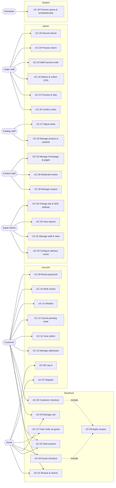
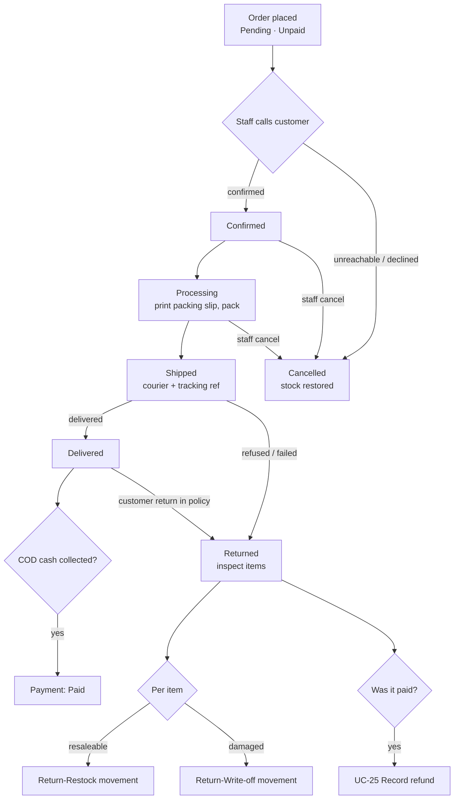
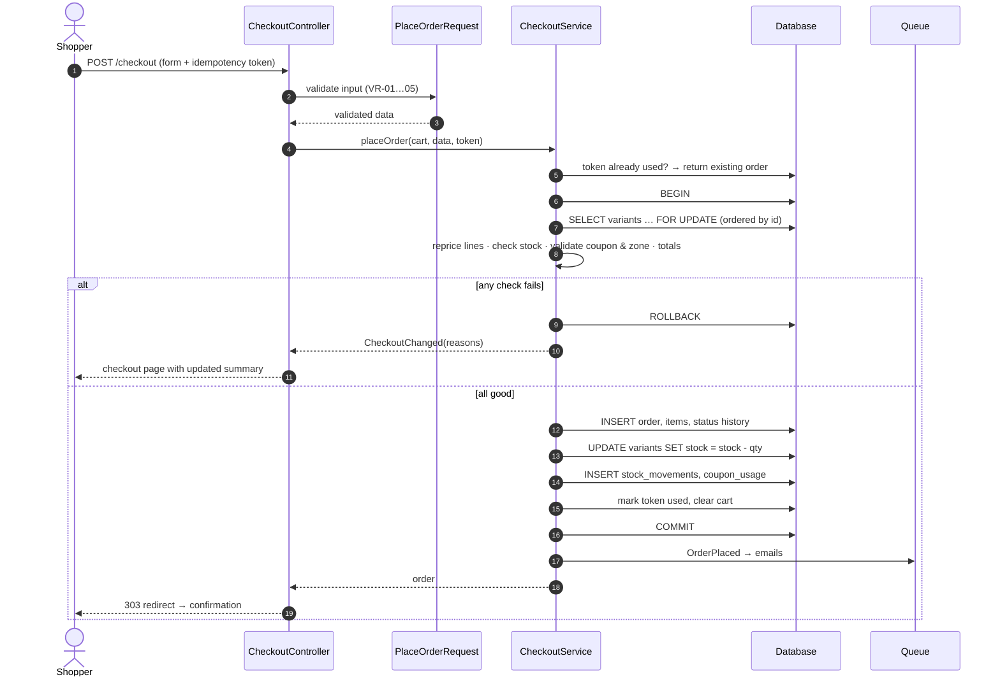

# DOC-03 — Use Cases & Workflows

| Field | Value |
|---|---|
| Project | Modern E-Commerce Website (Bangladesh) — working name **[Store Name]** |
| Document ID | DOC-03 |
| Version | 0.1 (Draft) |
| Date | 2026-10-13 |
| Prepared by | Claude (acting Senior BA) |
| Depends on | DOC-01 BRD v0.2, DOC-02 SRS v0.2 |
| Status | Draft — awaiting review |

---

## 1. Actors

| Actor | Type | Description |
|---|---|---|
| Guest | Primary, human | Unauthenticated visitor. Browses, uses cart, checks out as guest, tracks an order with order number + phone. |
| Customer | Primary, human | Registered, logged-in shopper. Everything a guest can do plus account, addresses, order history, wishlist, reviews. |
| Order Manager | Primary, human (staff) | Confirms, processes, ships, delivers, cancels orders; records COD collection, returns and refunds. |
| Catalog Manager | Primary, human (staff) | Maintains products, variants, images, prices and stock. |
| Content Editor | Primary, human (staff) | Banners, homepage sections, pages, coupons, review moderation, SEO text. |
| Support | Primary, human (staff) | Looks up orders and customers, read-mostly. |
| Store Manager | Primary, human (staff) | All operational permissions; reports. |
| Super Admin | Primary, human (staff) | All permissions incl. staff, roles and settings. |
| Delivery partner | Secondary, external | Delivers parcel, collects cash. Interacts with the system only through staff in MVP. |
| Mail server | Secondary, system | Sends transactional email. |
| Scheduler | Secondary, system | Cron-triggered jobs: queue processing, cart purge, sitemap, low-stock digest. |
| Payment gateway / Courier API / SMS | Secondary, system — **future** | Not active in MVP. |

Staff role names follow SRS §4; a use case names the **permission** required, so it remains valid if roles are re-arranged.

## 2. Use-case overview

(Mermaid has no native use-case notation; the flowchart above is the agreed equivalent. "include" means the coupon step is an optional part of both checkouts.)

## 3. Use-case catalogue

| ID | Use case | Primary actor | Priority | SRS refs |
|---|---|---|---|---|
| UC-01 | Browse categories, search, filter, sort | Guest / Customer | M | FR-SRC-001…006, FR-STF-001 |
| UC-02 | View product and select variant | Guest / Customer | M | FR-STF-005/006, FR-REV-003 |
| UC-03 | Manage cart | Guest / Customer | M | FR-CRT-001…006 |
| UC-04 | Guest checkout (COD) | Guest | M | FR-CHK-001…012, FR-INV-003 |
| UC-05 | Customer checkout (COD) | Customer | M | FR-CHK-*, FR-ACC-006 |
| UC-06 | Apply coupon | Guest / Customer | M | FR-CHK-004, FR-PRM-001…003 |
| UC-07 | Register | Guest | M | FR-ACC-001 |
| UC-08 | Log in / log out | Guest / Customer | M | FR-ACC-002, FR-CRT-002 |
| UC-09 | Reset password | Customer | M | FR-ACC-003 |
| UC-10 | Manage addresses and profile | Customer | M | FR-ACC-005/006 |
| UC-11 | View order history and detail | Customer | M | FR-ACC-007, FR-ORD-011 |
| UC-12 | Cancel own pending order | Customer | M | FR-ORD-008, FR-INV-004 |
| UC-13 | Track order as guest | Guest | M | FR-ACC-008 |
| UC-14 | Manage wishlist | Customer | M | FR-WSH-001/002 |
| UC-15 | Write review | Customer | M | FR-REV-001/002 |
| UC-20 | Confirm order | Order staff | M | FR-ORD-002 |
| UC-21 | Process and ship order | Order staff | M | FR-ORD-002/005/007 |
| UC-22 | Mark delivered and record COD collection | Order staff | M | FR-ORD-002, FR-PAY-003 |
| UC-23 | Staff cancels order | Order staff | M | FR-ORD-002, FR-INV-004, FR-PRM-003 |
| UC-24 | Process return | Order staff | M | FR-ORD-009, FR-INV-002 |
| UC-25 | Record refund | Order staff | M | FR-ORD-010 |
| UC-26 | Manage product, variants, images | Catalog staff | M | FR-CAT-001…011 |
| UC-27 | Adjust stock | Catalog staff | M | FR-INV-005/006 |
| UC-28 | Manage coupon | Content staff | M | FR-PRM-001…004 |
| UC-29 | Configure delivery zones and charges | Store Manager / Super Admin | M | FR-SHP-001…005 |
| UC-30 | Moderate review | Content staff | M | FR-REV-002/004 |
| UC-31 | Manage staff, roles and permissions | Super Admin | M | FR-ADM-001…004 |
| UC-32 | Manage homepage sections, banners, pages | Content staff | M | FR-STF-001/003/007 |
| UC-33 | View and export reports | Store Manager | M | FR-RPT-001…006 |
| UC-34 | Change site, payment and SEO settings | Super Admin | M | FR-SET-*, FR-PAY-002 |
| UC-40 | Process queue and scheduled jobs | Scheduler | M | FR-NTF-005, FR-CRT-007, FR-SET-003 |

## 4. Detailed use cases — customer side

### UC-04 Guest checkout (Cash on Delivery)

| Item | Description |
|---|---|
| Goal | A visitor buys items without creating an account. |
| Primary actor | Guest |
| Trigger | Guest selects "Checkout" from the cart or "Buy now" on a product. |
| Preconditions | Cart contains at least one active, in-stock line. COD is enabled. At least one delivery zone is active. |
| Postconditions (success) | Order exists with status Pending, payment Unpaid; stock deducted with Sale movements; coupon use counted (if any); cart emptied; confirmation shown; emails queued. |
| Postconditions (failure) | No order, no stock change, no coupon use; cart retained; reason shown. |

**Main flow**

1. System shows the checkout page with contact, address, delivery and payment sections and a live order summary, plus a one-time idempotency token.
2. Guest enters full name and mobile number (email optional).
3. Guest selects Division → District → Area/Thana and enters street address and optional instructions.
4. System resolves the delivery zone from area/district and shows delivery charge and estimate; summary updates.
5. *(Optional)* Guest applies a coupon → UC-06.
6. Guest sees Cash on Delivery selected (only enabled method) with its instructions.
7. Guest selects "Place order".
8. System validates all input (VR-01…05).
9. System, in one transaction: locks variant rows in ID order, re-reads prices, checks stock, re-validates coupon and zone, recalculates totals, creates order + items + status history, deducts stock and writes movements, records coupon usage, consumes the idempotency token.
10. System commits, empties the cart, queues the customer email (if email given) and staff new-order email.
11. System redirects to the confirmation page showing order number, summary, "We'll call you to confirm" and a tracking link; offers optional account creation with the details already given.

**Alternative flows**

- **A1 – Step 3, area not listed:** Guest chooses "Other area" and types it; zone resolves from district.
- **A2 – Step 4, district not in any active zone:** System shows "We don't deliver here yet — contact us" with contact details; "Place order" disabled (FR-SHP-005).
- **A3 – Step 4, subtotal after discount ≥ free threshold:** delivery charge shown as ৳0 with "Free delivery" label.
- **A4 – Step 11, guest creates account:** sets a password; system creates the account with the order's name/phone/email, links the order, logs the user in.
- **A5 – Buy now:** Product page's "Buy now" adds the selected variant and quantity to the cart and opens checkout directly.

**Exception flows**

- **E1 – Validation error (step 8):** form returned with field messages; input kept (EH-01).
- **E2 – Stock short (step 9):** rollback; cart quantities adjusted to available; message lists items (EH-02).
- **E3 – Price changed (step 9):** rollback; summary refreshed; guest must press "Place order" again (EH-03).
- **E4 – Coupon invalid now (step 9):** rollback; coupon removed; recalculated summary shown (EH-04).
- **E5 – Duplicate submission (step 7/9):** token already consumed → system shows the existing order's confirmation (EH-05).
- **E6 – Lock timeout/deadlock:** automatic retry up to 3 times, then "Please try again" (EH-06).
- **E7 – Rate limit:** too many attempts from IP/phone → 429 page (EH-12).
- **E8 – Email failure:** order unaffected; job retried (EH-10).

### UC-05 Customer checkout

Same as UC-04 with these differences:

- Step 2: name, phone, email prefilled from profile (editable for this order).
- Step 3: customer picks a saved address (default preselected) or "Add new address", with an option "Save to my address book".
- Step 11: confirmation links to the order in "My orders"; no account offer.
- **A6 – Session expired mid-checkout:** customer is asked to log in again; cart and entered data retained where safe (EH-13).

### UC-06 Apply coupon (included in UC-04/05)

1. Shopper enters a code and selects "Apply".
2. System normalises the code (upper-case, trimmed) and checks: exists, active, within dates, total and per-customer/phone limits, minimum subtotal, eligible items (if restricted).
3. System shows discount amount and new totals, or the specific reason for rejection (expired, minimum not met, not applicable to items, limit reached, invalid).
4. Shopper may remove the coupon.
- Final validation repeats inside the order transaction (UC-04 step 9).
- Per-phone limit applies before the phone is known only after step 2 of checkout; if the phone entered later exceeds the limit, coupon is removed with a message.

### UC-03 Manage cart (summary)

Add (from card or product page, variant required when options exist) → mini-cart opens with confirmation → cart page lists lines with image, name, variant, unit price, quantity stepper, line total, remove → subtotal and "Delivery calculated at checkout". Quantity changes are capped at stock/line max (FR-CRT-003). Price/stock change notices appear per line (FR-CRT-004). Unavailable lines are flagged and excluded (FR-CRT-005). On login the guest cart merges (FR-CRT-002).

### UC-12 Cancel own pending order

| Item | Description |
|---|---|
| Preconditions | Customer logged in; order belongs to customer; status Pending. |
| Main flow | 1. Customer opens order detail and selects "Cancel order". 2. System asks for a reason (list + other) and confirmation. 3. System transitions Pending → Cancelled in a transaction, restores stock (once), releases coupon use, records history with actor = customer. 4. Staff notified; customer sees updated status. |
| Exception | Status changed to Confirmed meanwhile → cancel refused, message "Your order is already confirmed — please contact us" with contact details. |

### UC-13 Track order as guest

1. Guest opens "Track order", enters order number and mobile number.
2. System looks up an order matching **both** (normalised phone); rate-limited.
3. Match → status timeline, items, totals, masked address (e.g. "House ••, Road ••, Dhanmondi, Dhaka").
4. No match → generic "We couldn't find an order with those details" (no indication of which field was wrong).

### UC-15 Write review

Preconditions: logged-in customer, email verified (S), has a Delivered (not Returned) order line for the product, no existing review for that line. Flow: from order detail or product page → rating + optional title/text → submitted as Pending → "Thanks, your review will appear after moderation". Exception: not eligible → button not shown; direct POST refused with 403.

### Other customer use cases (summary)

| UC | Main flow summary | Key exceptions |
|---|---|---|
| UC-01 | Category/search → listing with filters (URL-based), sort, pagination | No results → suggestions; rate limit on search |
| UC-02 | Product page → choose variant → price/stock/image update → add to cart / buy now / wishlist | Combination unavailable → disabled; out of stock → "Out of stock" and buttons disabled |
| UC-07 | Name, phone, email, password → account created → logged in → guest cart merged | Phone or email taken → message with login/reset links |
| UC-08 | Email or phone + password → logged in (session regenerated) → cart merged | 5 failed attempts/min → throttled; inactive account → message |
| UC-09 | Enter email → generic "if an account exists, we've sent a link" → link (60 min, single-use) → new password → other sessions logged out | Expired/used link → request a new one |
| UC-10 | Add/edit/delete address, set default; edit profile; change password with current password | Delete default → next address becomes default |
| UC-11 | List of own orders → detail with timeline | Other customer's order → 404 |
| UC-14 | Heart icon toggles wishlist; wishlist page with move-to-cart | Guest → login prompt, returns afterwards |

## 5. Detailed use cases — order processing (staff)

### 5.1 Order lifecycle workflow

### UC-20 Confirm order

| Item | Description |
|---|---|
| Actor / permission | Order staff — `orders.update-status` |
| Preconditions | Order Pending |
| Main flow | 1. Staff filters orders by Pending (oldest first). 2. Opens order; sees phone with tap-to-call, items, totals, address, customer's previous order count. 3. Calls customer, verifies order and address. 4. Optionally corrects address/contact (FR-ORD-006, audited). 5. Selects "Confirm" with optional note. 6. System records transition and history; queues customer email if enabled. |
| Alternatives | A1: Customer unreachable → staff adds note "attempt 1"; order stays Pending. A2: Customer declines → UC-23. |
| Exceptions | Order already moved by another staff member → refresh with message (optimistic check on current status). |

### UC-21 Process and ship order

1. Staff moves Confirmed → Processing (individually or bulk, S).
2. Prints packing slip/invoice (FR-ORD-007).
3. Packs, hands to courier, enters courier name and tracking reference (optional), moves Processing → Shipped.
4. System records history; customer email if enabled.

Exception: invalid transition attempted (e.g. bulk with mixed statuses) → those orders skipped and listed.

### UC-22 Mark delivered and record COD collection

1. Courier reports delivery (outside system in MVP).
2. Staff moves Shipped → Delivered; system prompts "Cash collected?".
3. Staff confirms amount collected (defaults to grand total) and date → payment status Paid with collector recorded.
- Alternative: cash settlement arrives later → staff records payment later from order detail.
- Exception: amount differs from total → reason required; payment recorded as amount collected, flagged for review.

### UC-23 Staff cancels order

Preconditions: status Pending, Confirmed or Processing; permission `orders.cancel`. Flow: select "Cancel" → reason required → system in one transaction sets Cancelled, restores stock once (guard column `stock_restored_at`), releases coupon use once, records history and audit → customer email if enabled. If any payment was recorded, system reminds staff to record a refund (UC-25).

### UC-24 Process return

| Item | Description |
|---|---|
| Actor / permission | Order staff — `orders.returns` |
| Preconditions | Order Shipped (refused/failed delivery) or Delivered (customer return within policy window — window shown as information, staff decide) |
| Main flow | 1. Staff selects "Record return". 2. Chooses return type (Delivery failed/refused, Customer return) and reason. 3. For each line: quantity returned (full order in MVP for refused delivery; per-line for customer return), condition: Resaleable / Damaged. 4. System sets status Returned, creates return record and items, Return-Restock movements for resaleable quantity, Return-Write-off movements (no stock change, recorded for reporting) for damaged quantity. 5. If payment Paid → prompt UC-25. |
| Exceptions | Quantity exceeds ordered quantity → refused. Partial customer return of some lines: order becomes Returned only when all lines are returned; otherwise MVP records a **partial return** on a Delivered order (status stays Delivered, return record attached). |

### UC-25 Record refund

Staff enters amount (≤ amount paid minus prior refunds), method (Cash, bKash personal, bank transfer, other — free text reference), date, note. System creates refund record, sets payment status to Partially Refunded or Refunded, audits. No money is moved by the system.

## 6. Detailed use cases — administration

### UC-26 Manage product, variants, images

1. Staff opens Products → "New product".
2. Enters basic info (name, slug auto, category, brand, descriptions, status Draft).
3. Selects option types used (e.g. Colour, Size) and their values.
4. System generates the variant matrix; staff fills SKU, price, compare-at, opening stock, threshold per variant, deactivates combinations not sold.
5. Uploads images, sets main image, alt text, links images to colour values.
6. Adds specifications and related products, SEO fields.
7. Saves; sets status Active when ready. System validates (VR-08…12), creates Opening stock movements, audits.
- Exceptions: duplicate SKU; invalid image (VR-10); activating with no active variant or no image → warning (image) / refusal (variant).
- Editing price later: audited old → new; open carts show new price (FR-CRT-004).

### UC-27 Adjust stock

Staff opens a variant's inventory → "Adjust" → type (Restock / Manual adjustment / Correction), signed quantity, mandatory reason → system locks the row, applies, refuses negative result, writes movement with user, audits.

### UC-28 Manage coupon

Create/edit fields per FR-PRM-001; system validates dates and values; deactivating a coupon affects new checkouts only; coupons with usage cannot be deleted, only deactivated.

### UC-29 Configure delivery zones and charges

Create zone (name, charge, free threshold, estimate text) → assign districts (multi-select by division) and optional area overrides → system warns about districts with no zone (deliveries there blocked) → save, audited. Changing a charge affects new checkouts only.

### UC-30 Moderate review

Pending queue → read review, product, verified-order link → Approve / Reject (optional internal reason) / Reply (S) → product rating aggregate recalculated → audited.

### UC-31 Manage staff, roles and permissions

Super Admin creates staff (name, email, initial password set by staff via invite link), assigns roles; edits role permission sets; deactivates staff (sessions ended). Exceptions: cannot deactivate/demote the last active Super Admin; cannot edit own roles.

### UC-32, UC-33, UC-34 (summary)

| UC | Summary |
|---|---|
| UC-32 | Reorder/enable homepage sections; banners with desktop/mobile images, schedule; edit static pages with sanitised rich text; preview before publish (S). |
| UC-33 | Choose report, period and filters → table and simple chart → CSV export (logged). Empty periods show empty state, not zeros dressed as data. |
| UC-34 | Edit store identity, contact, order-number prefix, notification toggles, COD settings, SEO defaults, robots; regenerate sitemap; all changes audited; cache cleared automatically. |

### UC-40 Process queue and scheduled jobs (system)

Cron runs `schedule:run` every minute. Scheduled tasks: process database queue (stop when empty / max time), purge stale guest carts (daily), regenerate sitemap (daily), low-stock digest (daily, S), prune old sessions/logs/failed jobs per retention. Failures logged; repeated failures visible on admin dashboard.

## 7. Key interaction: order placement transaction

## Change log

| Version | Date | Author | Change |
|---|---|---|---|
| 0.1 | 2026-10-13 | Claude | Initial draft |
