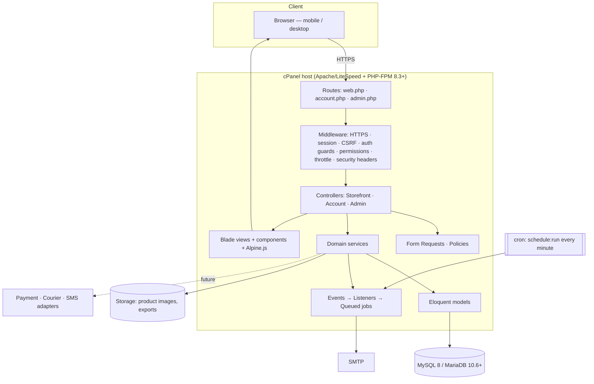
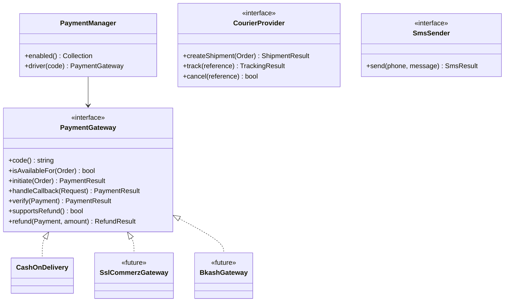

# DOC-05 — Software Architecture Document (SAD)

| Field | Value |
|---|---|
| Project | Modern E-Commerce Website (Bangladesh) — working name **[Store Name]** |
| Document ID | DOC-05 |
| Version | 0.1 (Draft) |
| Date | 2026-10-13 |
| Prepared by | Claude (acting Solution Architect) |
| Depends on | DOC-02 SRS v0.2 |
| Status | Draft — awaiting approval |

---

## 1. Architecture overview

A **modular monolith** built on Laravel: one deployable application, one MySQL/MariaDB database, two web areas (storefront and admin), with business logic organised into domain modules behind service classes. It is server-rendered (Blade) with small Alpine.js islands, which keeps pages fast on mobile, SEO-friendly and deployable on shared cPanel hosting without Node.js, Redis or long-running workers.



## 2. Technology decisions

| Concern | Choice | Justification |
|---|---|---|
| Language / runtime | PHP **8.3+** | Required by Laravel 13; widely offered by cPanel hosts. Confirm host version (BRD Q-06). |
| Framework | **Laravel 13** (current major; released Q1 2026, bug fixes to Q3 2027, security fixes to Q1 2028) | Mature, secure defaults, migrations, queues, auth, testing. Version pinned in `composer.json`; all framework APIs verified against the installed version at setup. |
| Database | MySQL 8.0+ or MariaDB 10.6+ (InnoDB, `utf8mb4_unicode_ci`) | Standard on cPanel; row-level locking and transactions; FULLTEXT for search; full Bangla text support. |
| Views | Blade + Blade components | Server-rendered, no runtime JS framework needed, SEO-friendly. |
| CSS | Tailwind CSS (v4 or the version current at setup) | Utility-first with design tokens (DOC-04), small production CSS. |
| Interactivity | Alpine.js | Lightweight (≈15 KB), declarative, suits islands (gallery, variant picker, cart drawer). |
| Build | Vite (Laravel plugin) | Builds assets before deployment; production needs no Node.js. |
| Customer auth | **Laravel Fortify** (headless auth backend) with custom Blade views | Provides registration, login, password reset, email verification, password confirmation, rate limiting; our own views keep design control. (Laravel's current starter kits target React/Vue/Livewire; Fortify fits Blade + Alpine.) |
| Admin auth | Separate `admin` guard + `admins` table, small custom login controller | Isolates staff from customers (ADR-003). |
| Authorisation | Policies/Gates + **spatie/laravel-permission** (roles & permissions for the `admin` guard) | Well-maintained, guard-aware, cached permission checks (ADR-004). |
| Rich text sanitising | **symfony/html-sanitizer** | Maintained, allow-list based, no heavy config (ADR-013). |
| Images | **intervention/image** (GD driver) | Resize/re-encode to WebP; GD is available on virtually all shared hosts (ADR-014). |
| Queue | Laravel `database` queue driver | No Redis on shared hosting; processed via scheduler (ADR-008). |
| Cache | `file` driver (or `database`) | Works on shared hosting; tags not required by design. |
| Sessions | `database` driver | Allows "log out other devices" and session inspection; survives deploys. |
| Mail | SMTP (hosting mail or a transactional provider) | Configurable via `.env`. |
| Tests | Pest (on PHPUnit) | Readable feature/unit tests; parallel option. |
| Code quality | Laravel Pint, Larastan (PHPStan) level ≥ 6 | Consistent style, early bug detection. |

Each third-party package is recorded in an ADR; anything else needs an ADR before it is added (NFR-MNT-03).

## 3. Application layers and responsibilities

| Layer | Location | Responsibility | Must not |
|---|---|---|---|
| Routing | `routes/web.php`, `routes/account.php`, `routes/admin.php` | URL → controller, middleware groups, route names | Contain logic |
| HTTP middleware | `app/Http/Middleware` + framework | HTTPS, sessions, CSRF, guards, permission checks, rate limits, security headers, locale | Business decisions |
| Controllers | `app/Http/Controllers/{Storefront,Account,Admin}` | Translate requests to service calls, choose views/redirects | Calculate prices, touch stock, run multi-step writes |
| Form Requests | `app/Http/Requests/...` | Validation (VR-*) and request-level authorisation | Persist data |
| Policies | `app/Policies` | Ownership and permission rules per model | — |
| Domain services | `app/Services/<Module>` | Business rules, transactions, orchestration | Render views, read request objects |
| Actions (optional) | `app/Actions/<Module>` | Single-purpose operations used by services (e.g. `RestoreOrderStock`) | — |
| Models | `app/Models` | Persistence, relationships, casts, scopes | Hold multi-model workflows |
| Enums | `app/Enums` | `OrderStatus` (with allowed transitions), `PaymentStatus`, `StockMovementType`, `CouponType` | — |
| Events / listeners / jobs | `app/Events`, `app/Listeners`, `app/Jobs` | Side effects after commit: email, audit, cache invalidation | Be required for order correctness |
| Integration adapters | `app/Integrations/{Payments,Couriers,Sms}` | External systems behind interfaces | Leak vendor types into domain |
| Views | `resources/views/{layouts,components,storefront,account,admin,emails}` | Presentation only | Query the database directly |

## 4. Module boundaries

| Module | Owns (main models) | Key services | Depends on |
|---|---|---|---|
| Catalog | Category, Brand, Product, ProductVariant, OptionType, OptionValue, ProductImage, ProductAttribute | `ProductService`, `VariantMatrixService`, `ImageService`, `SlugService` | Inventory (opening stock) |
| Inventory | StockMovement (+ `stock` on variant) | `InventoryService` (`deduct`, `restore`, `adjust`, all with locking) | Catalog |
| Pricing | — (pure logic) | `PricingService` (line totals, totals assembly) | Catalog, Promotions, Shipping |
| Promotions | Coupon, CouponUsage | `CouponService` (validate, calculate, record, release) | Catalog |
| Shipping | Division, District, Area, DeliveryZone | `ShippingService` (resolve zone, charge) | — |
| Cart | Cart, CartItem | `CartService` (add, update, merge, validate) | Catalog, Inventory, Pricing |
| Checkout | CheckoutToken (idempotency) | `CheckoutService` (`placeOrder`) | Cart, Pricing, Promotions, Shipping, Inventory, Orders, Payments |
| Orders | Order, OrderItem, OrderStatusHistory, OrderNote, OrderReturn, OrderReturnItem | `OrderService`, `OrderStatusService` (state machine), `ReturnService`, `OrderNumberGenerator` | Inventory, Promotions, Payments |
| Payments | Payment, Refund | `PaymentManager` + `PaymentGateway` implementations (`CashOnDelivery`) | Orders |
| Customers | User, Address | `CustomerService`, `AddressService` | — |
| Content | Banner, HomeSection, Page, Setting, SlugRedirect | `HomepageService`, `SettingsService` (cached) | Catalog |
| Reviews | Review, WishlistItem | `ReviewService`, `WishlistService` | Orders (eligibility) |
| Reporting | — (read models) | `ReportService` (queries, CSV export) | Orders, Inventory |
| Access | Admin, Role, Permission | `StaffService` | — |
| Audit | AuditLog | `AuditLogger` | all (listens) |
| SEO | — | `SitemapGenerator`, `SeoMeta` | Catalog, Content |

Rule: a module writes only its own tables; it calls other modules' services for their data. Cross-module reads through Eloquent relationships are allowed for display.

## 5. Proposed folder structure

```
app/
  Enums/                  OrderStatus.php  PaymentStatus.php  StockMovementType.php  CouponType.php
  Events/                 OrderPlaced.php  OrderStatusChanged.php  StockAdjusted.php ...
  Exceptions/             CheckoutChangedException.php  InsufficientStockException.php  InvalidTransitionException.php
  Http/
    Controllers/
      Storefront/         HomeController  ProductController  CategoryController  SearchController
                          CartController  CheckoutController  OrderTrackingController  PageController
      Account/            DashboardController  OrderController  AddressController  WishlistController
                          ReviewController  ProfileController
      Admin/              DashboardController  ProductController  VariantController  CategoryController
                          InventoryController  OrderController  OrderStatusController  ReturnController
                          CustomerController  CouponController  BannerController  HomeSectionController
                          PageController  ReviewController  DeliveryZoneController  PaymentSettingController
                          SettingController  StaffController  RoleController  ReportController  AuditLogController
                          Auth/LoginController
    Middleware/           SecurityHeaders.php  SetLocale.php
    Requests/             Storefront/  Account/  Admin/
  Integrations/
    Payments/             Contracts/PaymentGateway.php  CashOnDelivery.php  PaymentManager.php
    Couriers/             Contracts/CourierProvider.php            (interface only — future)
    Sms/                  Contracts/SmsSender.php                  (interface only — future)
  Listeners/  Jobs/  Mail/
  Models/
  Policies/               OrderPolicy  AddressPolicy  ReviewPolicy ...
  Providers/
  Services/
    Catalog/  Inventory/  Pricing/  Promotions/  Shipping/  Cart/  Checkout/
    Orders/  Content/  Reviews/  Reporting/  Audit/  Seo/
  Support/                Money.php  BdPhone.php  ...
  View/Components/
bootstrap/  config/
database/
  factories/  migrations/
  seeders/                RoleAndPermissionSeeder  BangladeshGeoSeeder  SettingsSeeder  SuperAdminSeeder
                          DemoCatalogSeeder (local/staging only)
lang/en/                  (lang/bn/ later)
public/
resources/
  css/app.css  js/app.js  js/components/
  views/  layouts/  components/  storefront/  account/  admin/  emails/  errors/
routes/                   web.php  account.php  admin.php  console.php
tests/
  Feature/  Unit/  Concurrency/
docs/
```

## 6. Request flow and key designs

### 6.1 Checkout and order placement

Defined in DOC-03 §7. Architectural points:

- `CheckoutService::placeOrder()` is the **only** code path that creates orders.
- Wrapped in `DB::transaction(..., attempts: 3)` so deadlocks are retried (EH-06).
- Variant rows locked with `lockForUpdate()` sorted by primary key to prevent deadlocks between overlapping carts.
- Stock deduction uses a guarded update (`UPDATE … SET stock = stock - ? WHERE id = ? AND stock >= ?`) and checks affected rows — a second safety net besides the lock.
- Idempotency: `checkout_tokens` row created when the checkout page renders (bound to cart and session); `placeOrder` marks it used inside the transaction and stores `order_id`. A repeat with a used token returns that order.
- Side effects (email) dispatched with `afterCommit` so they only fire for committed orders.

### 6.2 Order state machine

`OrderStatus` enum exposes `allowedTransitions()`; `OrderStatusService::transition($order, $to, $actor, $note)` checks the transition, the actor's permission (via policy), runs side effects (stock restore, coupon release) in a transaction, writes `order_status_histories` and an audit entry, and raises `OrderStatusChanged`. Guard columns (`stock_restored_at`, `coupon_released_at`) make side effects exactly-once.

### 6.3 Pricing

`PricingService` is pure (no I/O beyond the inputs given) and fully unit-tested: it receives variant prices, quantities, coupon and zone and returns a `PriceBreakdown` value object. Cart, checkout page and order placement all call it, so displayed and charged totals cannot diverge. Inside the service all arithmetic uses integer poisha (amount × 100) to avoid floating-point errors; amounts are stored as DECIMAL(12,2) (ADR-009).

### 6.4 Settings and caching

`SettingsService` loads all settings once per request from cache (`settings` key, invalidated on save). Homepage sections, category tree and menu are cached for 10 minutes and invalidated by model events. Production runs `config:cache`, `route:cache`, `view:cache`, `event:cache`.

## 7. Authentication and authorisation design

| Aspect | Customers | Staff |
|---|---|---|
| Guard | `web` (session) | `admin` (session) |
| Provider / table | `users` | `admins` |
| Login | Email **or** mobile + password (Fortify custom `authenticateUsing`) | Email + password; TOTP 2FA (S) |
| Routes | `/login`, `/register`, `/forgot-password`, `/account/*` | `/admin/login`, `/admin/*` |
| Password reset | Fortify, broker `users` | Admin-initiated invite/reset link, broker `admins` |
| Rate limiting | `login` limiter: 5/min per email+IP; reset 3/15 min | 5/min per email+IP, lockout notice |
| Authorisation | Policies: owner-only access to orders, addresses, reviews, wishlist | `permission:` middleware per route group + policies; spatie roles scoped to `admin` guard |
| Session | Regenerated on login; idle lifetime 120 min; remember-me 30 days | Regenerated on login; idle 120 min; no remember-me |
| Cookies | `Secure`, `HttpOnly`, `SameSite=Lax`; separate session cookie names not required (guards share session store but are independent) | Same |

Guest order access: confirmation via a **signed URL** (`URL::temporarySignedRoute`, 24 h) plus session check; tracking via order number + phone with throttling (6/min per IP).

Permission naming: `<resource>.<ability>` e.g. `products.view`, `products.edit`, `products.price`, `inventory.adjust`, `orders.view`, `orders.update-status`, `orders.cancel`, `orders.returns`, `orders.payments`, `customers.view`, `customers.manage`, `coupons.manage`, `content.manage`, `reviews.moderate`, `settings.manage`, `settings.seo`, `shipping.manage`, `payments.manage`, `staff.manage`, `reports.view`, `audit.view`. Seeded by `RoleAndPermissionSeeder`; default roles per SRS §4.

## 8. API strategy

- **MVP:** no public API. Storefront uses a handful of internal JSON endpoints under `web` middleware (session + CSRF + throttle): `POST /cart/items`, `PATCH /cart/items/{id}`, `DELETE /cart/items/{id}`, `GET /product/{slug}/variants`, `POST /checkout/coupon`, `GET /geo/districts/{division}`, `GET /geo/areas/{district}`, `GET /search/suggest`. These return consistent JSON (`{data}` / `{message, errors}`) and are documented in DOC-09.
- Every JSON endpoint has a non-JS fallback where it affects core flows (add to cart, coupon, address selects work as normal form posts).
- **Future (FS-08):** versioned `/api/v1` with Laravel Sanctum token auth, API Resources, the same domain services. No refactor of business logic needed because controllers already delegate to services.
- Webhooks (future gateways/couriers): `/webhooks/{provider}` excluded from CSRF, verified by signature/IP allow-list, idempotent by provider event ID (DOC-09).

## 9. Integration architecture



- `CashOnDelivery::initiate()` creates a `payments` row (status Unpaid, method `cod`) and returns "no redirect".
- Future gateways add a class, config and a settings form; order flow already supports `payment_status = Pending` and callback handling.
- Courier and SMS: interfaces and config placeholders only; staff enter courier/tracking manually in MVP. Notifications use Laravel's notification system so an SMS channel can be added later.
- Gateway/courier/SMS credentials stored only in `.env` (never in DB settings or source control).

## 10. Deployment architecture

### 10.1 Environments

| Environment | Purpose | Data |
|---|---|---|
| Local | Development (Laravel Herd/Sail/XAMPP, MySQL) | Demo seeders |
| Staging | UAT on the same type of cPanel host (sub-domain, `noindex`, basic auth) | Demo + test data |
| Production | Live store | Real data; demo seeder never run |

### 10.2 Production on shared cPanel

```
/home/<account>/
  app/                       ← Laravel project (NOT web-accessible): app, bootstrap, config, database,
                               resources, routes, storage, vendor, .env
  public_html/  (document root)
    index.php                ← adjusted paths to ../app/vendor and ../app/bootstrap
    .htaccess                ← rewrite + security headers + deny dotfiles
    build/                   ← Vite output
    storage → ../app/storage/app/public   (symlink; or public disk rooted here if symlinks are blocked)
    favicon, robots.txt (served by route), etc.
```

Preferred alternative when the host allows choosing a document root for the domain: point it directly to `app/public` and keep the standard Laravel layout.

- **Cron:** `* * * * * /usr/local/bin/php /home/<account>/app/artisan schedule:run >> /dev/null 2>&1` (PHP binary path confirmed on host).
- **Queue:** scheduler runs `queue:work --stop-when-empty --max-time=50 --tries=3` every minute `withoutOverlapping()`.
- **Build pipeline:** `composer install --no-dev --optimize-autoloader` and `npm ci && npm run build` run in CI (GitHub Actions) or locally; artefact deployed by SSH/rsync or cPanel Git™ Version Control with `.cpanel.yml`; FTP upload path documented for hosts without SSH.
- **Release steps:** maintenance mode → upload → `migrate --force` → caches rebuilt → `queue:restart` → maintenance off. Full procedure and rollback in DOC-10.
- **HTTPS:** AutoSSL / Let's Encrypt via cPanel; HTTP → HTTPS redirect and HSTS.
- **Backups:** cPanel/JetBackup daily plus application-level `mysqldump` job to off-server storage (DOC-10).

### 10.3 Scaling path (if A-10 limits are exceeded)

VPS with PHP-FPM + Nginx, Redis for cache/session/queue, Supervisor for queue workers, optional Meilisearch for search — achieved by configuration changes (drivers) rather than code rewrites.

## 11. Cross-cutting concerns

- **Security:** see SRS NFR-SEC; `SecurityHeaders` middleware (CSP, HSTS, X-Content-Type-Options, Referrer-Policy, Permissions-Policy, frame-ancestors 'none' for admin); trusted proxies configured if behind Cloudflare.
- **Logging:** `daily` channel, 14-day retention, no personal data or secrets in logs (phone masked); critical errors emailed to admin address (rate-limited).
- **Localisation:** all strings via `__()`; `SetLocale` middleware ready; content translations designed in DOC-06 §6.
- **Time:** stored UTC, displayed Asia/Dhaka.
- **Observability:** admin "System health" panel (S): queue backlog, failed jobs, last scheduler run, last backup timestamp, disk usage.

## 12. Architecture decision records (summary)

Full ADRs will be stored as `docs/adr/ADR-NNN-title.md` once approved.

| ADR | Decision | Status | Main alternative rejected |
|---|---|---|---|
| ADR-001 | Modular monolith in one Laravel app | Proposed | Microservices — unjustified complexity, not deployable on shared hosting |
| ADR-002 | Blade + Alpine.js islands | Proposed | SPA (React/Vue) or Livewire — heavier, SEO/hosting cost, not needed |
| ADR-003 | Separate `admins` table and `admin` guard | Proposed | Single users table with role flag — higher risk of privilege mix-ups |
| ADR-004 | spatie/laravel-permission for RBAC | Proposed | Hand-built RBAC — more code to secure and test |
| ADR-005 | Laravel Fortify for customer auth with custom Blade views | Proposed | Livewire starter kit — adds Livewire dependency |
| ADR-006 | Deduct stock at order placement with pessimistic row locks | Proposed | Deduct at confirmation — oversell risk between placement and confirmation |
| ADR-007 | Every product has ≥ 1 variant; stock/SKU/price live on variants | Proposed | Dual product/variant stock — two code paths, bugs |
| ADR-008 | Database queue processed by cron scheduler | Proposed | Redis + Supervisor — unavailable on shared hosting |
| ADR-009 | Money as DECIMAL(12,2); integer poisha arithmetic in PricingService | Proposed | Floats — rounding errors |
| ADR-010 | Orders snapshot product, price and address data | Proposed | Referencing live catalogue — history changes when products change |
| ADR-011 | Payment gateways via strategy interface; COD only enabled | Proposed | Hard-coded COD — costly to add gateways later |
| ADR-012 | No public API in MVP; internal JSON endpoints only | Proposed | API-first — extra surface area to secure |
| ADR-013 | symfony/html-sanitizer for rich text | Proposed | HTMLPurifier — heavier, slower |
| ADR-014 | intervention/image (GD) for image processing | Proposed | Imagick — not always available on shared hosts |
| ADR-015 | MySQL FULLTEXT + LIKE fallback for search | Proposed | External search engine — not available on shared hosting |
| ADR-016 | Translation-ready UI now; content translation tables in FS-04 | Proposed | Full multilingual content now — scope and cost |

## Change log

| Version | Date | Author | Change |
|---|---|---|---|
| 0.1 | 2026-10-13 | Claude | Initial draft |
