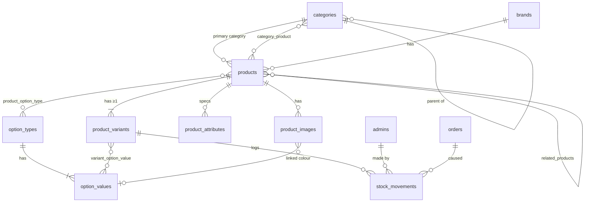
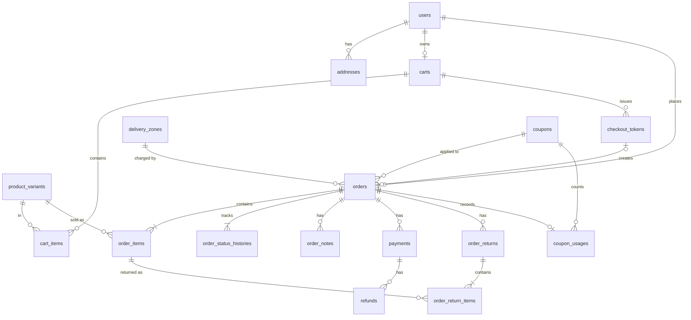
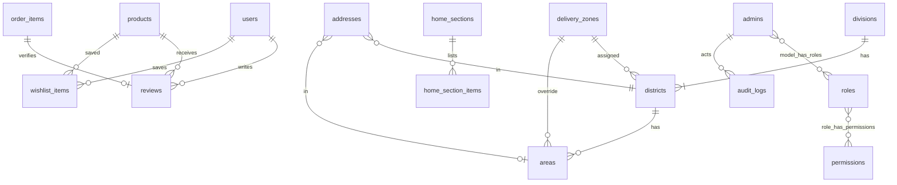

# DOC-06 — Database Design Document

| Field | Value |
|---|---|
| Project | Modern E-Commerce Website (Bangladesh) — working name **[Store Name]** |
| Document ID | DOC-06 |
| Version | 0.1 (Draft) |
| Date | 2026-10-13 |
| Prepared by | Claude (acting Database Architect) |
| Depends on | DOC-02 SRS v0.2, DOC-05 SAD v0.1 |
| Status | Draft — awaiting approval |

---

## 1. Conventions

- Engine InnoDB, charset `utf8mb4`, collation `utf8mb4_unicode_ci` (Bangla-safe). Target MySQL 8.0+ / MariaDB 10.6+.
- Table names plural snake_case; pivot tables singular names in alphabetical order (`category_product`); primary key `id BIGINT UNSIGNED AUTO_INCREMENT` unless stated.
- Foreign keys `<entity>_id`, constrained; on-delete behaviour stated per FK (`restrict` by default for anything referenced by orders).
- `created_at`, `updated_at` TIMESTAMP on all tables unless marked *(no timestamps)*; stored in UTC.
- Money: `DECIMAL(12,2)` BDT. Quantities: `INT UNSIGNED`. Flags: `BOOLEAN`.
- Statuses/types: `VARCHAR(20)` holding PHP backed-enum values (portable across MySQL/MariaDB; changes need no ALTER of ENUM).
- Soft deletes (`deleted_at`) only where history must survive: `products`, `product_variants`, `categories`, `coupons`, `users`, `admins`.
- Phone numbers stored normalised `01XXXXXXXXX` in `VARCHAR(11)`.
- All schema changes via Laravel migrations; no manual DDL in production.

Legend in table definitions: **PK** primary key · **FK** foreign key · **UQ** unique · **IX** index · **N** nullable.

## 2. Entity-relationship diagrams

### 2.1 Catalogue and inventory

### 2.2 Customers, cart, checkout, orders, payments

### 2.3 Geography, delivery, content, reviews, access, audit

## 3. Table definitions

### 3.1 Access and customers

**`users`** — registered customers (soft deletes)

| Column | Type | Constraints | Description |
|---|---|---|---|
| id | BIGINT UNSIGNED | PK | |
| name | VARCHAR(100) | | Full name |
| phone | VARCHAR(11) | UQ | Normalised BD mobile |
| email | VARCHAR(191) | UQ | |
| email_verified_at | TIMESTAMP | N | |
| password | VARCHAR(255) | | Hash |
| remember_token | VARCHAR(100) | N | |
| is_active | BOOLEAN | default true, IX | Deactivated by staff |
| last_login_at | TIMESTAMP | N | |
| deleted_at | TIMESTAMP | N | Anonymisation on deletion request (FR-ACC-011) |

**`admins`** — staff (soft deletes): `id`, `name` VARCHAR(100), `email` VARCHAR(191) UQ, `password`, `two_factor_secret` TEXT N (encrypted cast), `two_factor_recovery_codes` TEXT N (encrypted), `two_factor_confirmed_at` TIMESTAMP N, `is_active` BOOLEAN, `last_login_at` N, `remember_token` N, `deleted_at` N.

**Roles & permissions** — standard spatie/laravel-permission tables: `roles` (id, name, guard_name; UQ name+guard_name), `permissions` (same), `model_has_roles`, `model_has_permissions`, `role_has_permissions`. All rows use `guard_name = 'admin'`.

**Framework tables**: `password_reset_tokens` (email PK, token, created_at), `admin_password_reset_tokens` (same shape), `sessions` (id PK, user_id N IX, ip_address, user_agent, payload, last_activity IX), `cache`, `cache_locks`, `jobs`, `job_batches`, `failed_jobs`.

**`addresses`**

| Column | Type | Constraints | Description |
|---|---|---|---|
| id | BIGINT UNSIGNED | PK | |
| user_id | BIGINT UNSIGNED | FK users cascade, IX | |
| label | VARCHAR(30) | N | "Home", "Office" |
| recipient_name | VARCHAR(100) | | |
| phone | VARCHAR(11) | | |
| division_id | SMALLINT UNSIGNED | FK divisions restrict | |
| district_id | SMALLINT UNSIGNED | FK districts restrict | |
| area_id | INT UNSIGNED | FK areas set null, N | |
| area_text | VARCHAR(100) | N | When area not in list |
| address_line | VARCHAR(255) | | House/road/details |
| postcode | CHAR(4) | N | |
| is_default | BOOLEAN | default false | One default per user (enforced in service) |

### 3.2 Geography and delivery

**`divisions`** *(no timestamps)*: `id` SMALLINT UNSIGNED PK, `name` VARCHAR(50) UQ, `name_bn` VARCHAR(50) N, `sort_order` SMALLINT.

**`districts`**: `id` SMALLINT UNSIGNED PK, `division_id` FK divisions restrict IX, `name` VARCHAR(50) UQ, `name_bn` N, `delivery_zone_id` FK delivery_zones set null N IX, `is_active` BOOLEAN. A district's zone is a single column, so **a district can never be in two zones**; null = no delivery (FR-SHP-005).

**`areas`**: `id` INT UNSIGNED PK, `district_id` FK cascade IX, `name` VARCHAR(100), `name_bn` N, `delivery_zone_id` FK set null N (override), `is_active`. UQ (`district_id`, `name`).

**`delivery_zones`**

| Column | Type | Constraints | Description |
|---|---|---|---|
| id | BIGINT UNSIGNED | PK | |
| name | VARCHAR(60) | UQ | e.g. Inside Dhaka |
| base_charge | DECIMAL(12,2) | ≥ 0 | |
| free_delivery_threshold | DECIMAL(12,2) | N | Null = never free |
| estimate_text | VARCHAR(60) | N | "1–2 days" |
| is_active | BOOLEAN | IX | |
| sort_order | SMALLINT | | |

Zone resolution: `areas.delivery_zone_id` → else `districts.delivery_zone_id` → else not deliverable.

### 3.3 Catalogue

**`categories`** (soft deletes)

| Column | Type | Constraints | Description |
|---|---|---|---|
| id | BIGINT UNSIGNED | PK | |
| parent_id | BIGINT UNSIGNED | FK categories restrict, N, IX | Max depth 3 (service-enforced) |
| name | VARCHAR(120) | | |
| slug | VARCHAR(140) | UQ | |
| description | TEXT | N | |
| image_path | VARCHAR(255) | N | |
| meta_title, meta_description | VARCHAR(160), VARCHAR(255) | N | |
| sort_order | INT | IX (parent_id, sort_order) | |
| is_active | BOOLEAN | IX | |

**`brands`**: `id`, `name` VARCHAR(120) UQ, `slug` UQ, `logo_path` N, `is_active`.

**`products`** (soft deletes)

| Column | Type | Constraints | Description |
|---|---|---|---|
| id | BIGINT UNSIGNED | PK | |
| category_id | BIGINT UNSIGNED | FK categories restrict, IX | Primary category |
| brand_id | BIGINT UNSIGNED | FK brands set null, N, IX | |
| name | VARCHAR(200) | FULLTEXT (name, short_description) | |
| slug | VARCHAR(220) | UQ | |
| short_description | VARCHAR(500) | N | |
| description | MEDIUMTEXT | N | Sanitised HTML |
| status | VARCHAR(20) | IX | draft / active / archived |
| is_featured | BOOLEAN | IX | |
| min_price | DECIMAL(12,2) | IX | Denormalised from active variants for sorting/filtering |
| max_price | DECIMAL(12,2) | | |
| in_stock | BOOLEAN | IX | Denormalised: any active variant with stock > 0 |
| rating_avg | DECIMAL(3,2) | N | From approved reviews |
| rating_count | INT UNSIGNED | default 0 | |
| sold_count_30d | INT UNSIGNED | default 0, IX | Recomputed nightly for "best sellers" |
| meta_title, meta_description | | N | |
| published_at | TIMESTAMP | N, IX | For "New arrivals" ordering |
| created_by, updated_by | BIGINT UNSIGNED | FK admins set null, N | |

Composite IX (`status`, `category_id`, `min_price`) and (`status`, `published_at`) for listing queries. Denormalised columns are refreshed by `ProductService` whenever variants, stock or reviews change.

**`category_product`** *(no timestamps)*: `category_id` FK cascade, `product_id` FK cascade; PK (category_id, product_id). Additional categories.

**`option_types`**: `id`, `name` VARCHAR(50) UQ (Colour, Size…), `display_style` VARCHAR(20) (swatch / chip / dropdown), `sort_order`.

**`option_values`**: `id`, `option_type_id` FK cascade IX, `value` VARCHAR(60), `swatch_hex` CHAR(7) N, `sort_order`. UQ (`option_type_id`, `value`).

**`product_option_type`** *(no timestamps)*: PK (`product_id`, `option_type_id`), `sort_order`.

**`product_variants`** (soft deletes)

| Column | Type | Constraints | Description |
|---|---|---|---|
| id | BIGINT UNSIGNED | PK | |
| product_id | BIGINT UNSIGNED | FK products cascade, IX | |
| sku | VARCHAR(64) | UQ | |
| barcode | VARCHAR(64) | N, IX | |
| price | DECIMAL(12,2) | ≥ 0 | |
| compare_at_price | DECIMAL(12,2) | N | Shown only if > price |
| stock | INT UNSIGNED | default 0 | **Unsigned: cannot go negative at DB level** |
| low_stock_threshold | INT UNSIGNED | N | Null = global default |
| weight_grams | INT UNSIGNED | N | |
| is_default | BOOLEAN | | The single variant of an option-less product |
| is_active | BOOLEAN | IX | |
| option_signature | VARCHAR(191) | UQ (product_id, option_signature) | Sorted option_value ids, e.g. "3-17"; prevents duplicate combinations |
| sort_order | INT | | |

**`variant_option_value`** *(no timestamps)*: PK (`product_variant_id`, `option_value_id`).

**`product_images`**: `id`, `product_id` FK cascade IX, `option_value_id` FK set null N, `path` VARCHAR(255) (base path; size variants derived), `alt_text` VARCHAR(200) N, `width`, `height` SMALLINT UNSIGNED, `is_main` BOOLEAN, `sort_order`.

**`product_attributes`**: `id`, `product_id` FK cascade IX, `label` VARCHAR(80), `value` VARCHAR(255), `sort_order`.

**`related_products`** *(no timestamps)*: PK (`product_id`, `related_product_id`), both FK products cascade, `sort_order`.

### 3.4 Inventory

**`stock_movements`** — append-only ledger

| Column | Type | Constraints | Description |
|---|---|---|---|
| id | BIGINT UNSIGNED | PK | |
| product_variant_id | BIGINT UNSIGNED | FK product_variants restrict, IX (variant, created_at) | |
| type | VARCHAR(20) | IX | opening, restock, sale, cancellation, return_restock, return_writeoff, adjustment, correction |
| quantity | INT | | Signed change (write-off rows carry the written-off quantity with `affects_stock = false`) |
| affects_stock | BOOLEAN | default true | |
| balance_after | INT UNSIGNED | | Stock after this movement |
| reason | VARCHAR(255) | N | Required for adjustment/correction |
| order_id | BIGINT UNSIGNED | FK orders restrict, N, IX | |
| order_return_id | BIGINT UNSIGNED | FK order_returns restrict, N | |
| admin_id | BIGINT UNSIGNED | FK admins restrict, N | Staff actor; null for system/customer |
| created_at | TIMESTAMP | | No `updated_at` (immutable) |

### 3.5 Cart and checkout

**`carts`**: `id`, `user_id` FK users cascade N UQ, `token` CHAR(40) UQ (guest cookie value, random), `last_activity_at` IX, timestamps. One cart per user; guest carts by token.

**`cart_items`**: `id`, `cart_id` FK cascade IX, `product_variant_id` FK cascade, `quantity` INT UNSIGNED, `price_at_add` DECIMAL(12,2) (only for "price changed" notice, never for charging), timestamps. UQ (`cart_id`, `product_variant_id`).

**`checkout_tokens`** — idempotency

| Column | Type | Constraints | Description |
|---|---|---|---|
| id | BIGINT UNSIGNED | PK | |
| token | CHAR(40) | UQ | Random, embedded in checkout form |
| cart_id | BIGINT UNSIGNED | FK carts set null, N | |
| session_id | VARCHAR(255) | IX | Binding to session |
| used_at | TIMESTAMP | N | Set inside order transaction |
| order_id | BIGINT UNSIGNED | FK orders set null, N, UQ | |
| expires_at | TIMESTAMP | IX | 2 h |

### 3.6 Promotions

**`coupons`** (soft deletes)

| Column | Type | Constraints | Description |
|---|---|---|---|
| id | BIGINT UNSIGNED | PK | |
| code | VARCHAR(32) | UQ | Stored upper-case |
| description | VARCHAR(255) | N | Internal |
| type | VARCHAR(20) | | percentage / fixed / free_delivery |
| value | DECIMAL(12,2) | | % (0–100) or ৳ |
| max_discount | DECIMAL(12,2) | N | Cap for percentage |
| min_subtotal | DECIMAL(12,2) | N | |
| starts_at, ends_at | TIMESTAMP | N, IX | |
| usage_limit | INT UNSIGNED | N | Total |
| per_customer_limit | INT UNSIGNED | N | By user_id or phone |
| used_count | INT UNSIGNED | default 0 | Maintained in order transaction (row locked) |
| applies_to | VARCHAR(20) | | all / categories / products |
| is_active | BOOLEAN | IX | |
| created_by | BIGINT UNSIGNED | FK admins set null, N | |

**`coupon_category`**, **`coupon_product`** *(no timestamps)*: pivots for restrictions.

**`coupon_usages`**: `id`, `coupon_id` FK restrict IX, `order_id` FK cascade UQ, `user_id` FK set null N IX, `phone` VARCHAR(11) IX, `discount_amount` DECIMAL(12,2), `released_at` TIMESTAMP N (on cancellation), `created_at`. Per-customer counting excludes released rows.

### 3.7 Orders and payments

**`orders`**

| Column | Type | Constraints | Description |
|---|---|---|---|
| id | BIGINT UNSIGNED | PK | |
| order_number | VARCHAR(24) | UQ | e.g. ST-261013-4K7Q2 |
| user_id | BIGINT UNSIGNED | FK users set null, N, IX | Null for guest |
| status | VARCHAR(20) | IX (status, placed_at) | pending … returned |
| payment_status | VARCHAR(20) | IX | unpaid, pending, paid, failed, partially_refunded, refunded |
| payment_method | VARCHAR(30) | | `cod` |
| customer_name | VARCHAR(100) | | Snapshot |
| phone | VARCHAR(11) | IX | Snapshot; used for guest tracking |
| email | VARCHAR(191) | N | |
| division_name, district_name | VARCHAR(50) | | Snapshot |
| area_name | VARCHAR(100) | N | Snapshot (list or free text) |
| district_id | SMALLINT UNSIGNED | FK districts set null, N | For reports |
| address_line | VARCHAR(255) | | |
| postcode | CHAR(4) | N | |
| delivery_instructions | VARCHAR(500) | N | |
| delivery_zone_id | BIGINT UNSIGNED | FK delivery_zones set null, N | |
| delivery_zone_name | VARCHAR(60) | | Snapshot |
| subtotal | DECIMAL(12,2) | | |
| discount_total | DECIMAL(12,2) | default 0 | |
| delivery_charge | DECIMAL(12,2) | | |
| grand_total | DECIMAL(12,2) | | = subtotal − discount + delivery |
| coupon_id | BIGINT UNSIGNED | FK coupons set null, N | |
| coupon_code | VARCHAR(32) | N | Snapshot |
| courier_name | VARCHAR(60) | N | |
| tracking_reference | VARCHAR(100) | N | |
| customer_note | VARCHAR(500) | N | |
| cancel_reason | VARCHAR(255) | N | |
| stock_restored_at | TIMESTAMP | N | Exactly-once guard |
| placed_at | TIMESTAMP | IX | |
| confirmed_at, shipped_at, delivered_at, cancelled_at, returned_at | TIMESTAMP | N | |
| ip_address | VARCHAR(45) | N | Fraud review |
| user_agent | VARCHAR(255) | N | |

**`order_items`**: `id`, `order_id` FK cascade IX, `product_id` FK products set null N, `product_variant_id` FK product_variants set null N IX, `product_name` VARCHAR(200), `variant_label` VARCHAR(191) N ("Black / Large"), `sku` VARCHAR(64), `image_path` VARCHAR(255) N, `unit_price` DECIMAL(12,2), `compare_at_price` N, `quantity` INT UNSIGNED, `discount_amount` DECIMAL(12,2) default 0 (allocated share), `line_total` DECIMAL(12,2), `returned_quantity` INT UNSIGNED default 0.

**`order_status_histories`**: `id`, `order_id` FK cascade IX, `from_status` VARCHAR(20) N, `to_status` VARCHAR(20), `actor_type` VARCHAR(20) (admin / customer / system), `actor_id` BIGINT UNSIGNED N, `note` VARCHAR(500) N, `is_customer_visible` BOOLEAN, `created_at`.

**`order_notes`**: `id`, `order_id` FK cascade IX, `admin_id` FK restrict, `body` TEXT, `created_at`. Internal only.

**`payments`**: `id`, `order_id` FK restrict IX, `method` VARCHAR(30), `status` VARCHAR(20), `amount` DECIMAL(12,2), `collected_amount` DECIMAL(12,2) N, `collected_at` N, `recorded_by` FK admins N, `provider_reference` VARCHAR(100) N UQ (future: gateway transaction id), `provider_payload` JSON N (future, sanitised — never card data), timestamps.

**`refunds`**: `id`, `payment_id` FK restrict IX, `order_id` FK restrict IX, `amount` DECIMAL(12,2), `method` VARCHAR(30), `reference` VARCHAR(100) N, `note` VARCHAR(255) N, `refunded_at` TIMESTAMP, `recorded_by` FK admins restrict, timestamps.

**`order_returns`**: `id`, `order_id` FK restrict IX, `type` VARCHAR(20) (delivery_failed / customer_return), `reason` VARCHAR(255), `processed_by` FK admins restrict, `processed_at`, timestamps.

**`order_return_items`**: `id`, `order_return_id` FK cascade, `order_item_id` FK restrict, `quantity` INT UNSIGNED, `condition` VARCHAR(20) (resaleable / damaged).

### 3.8 Reviews and wishlist

**`reviews`**: `id`, `product_id` FK cascade IX, `user_id` FK set null N, `order_item_id` FK set null N UQ (one review per purchased line), `rating` TINYINT UNSIGNED (1–5), `title` VARCHAR(120) N, `body` TEXT N, `status` VARCHAR(20) IX (pending / approved / rejected), `moderated_by` FK admins N, `moderated_at` N, `reply` TEXT N, `replied_at` N, timestamps. IX (`product_id`, `status`, `created_at`).

**`wishlist_items`**: `id`, `user_id` FK cascade, `product_id` FK cascade, `created_at`. UQ (`user_id`, `product_id`).

### 3.9 Content, settings, SEO

**`banners`**: `id`, `placement` VARCHAR(30) IX (hero / promo), `title` VARCHAR(120) N, `subtitle` VARCHAR(255) N, `button_label` VARCHAR(40) N, `link_url` VARCHAR(255) N, `image_desktop_path`, `image_mobile_path` N, `alt_text` VARCHAR(200), `starts_at`, `ends_at` N, `sort_order`, `is_active`, timestamps.

**`home_sections`**: `id`, `type` VARCHAR(30) (hero, categories, featured, latest, best_sellers, promo_banner, trust, how_it_works, newsletter, product_list), `title` VARCHAR(120) N, `settings` JSON N (limits, tabs), `sort_order`, `is_active`.

**`home_section_items`**: `id`, `home_section_id` FK cascade, `item_type` VARCHAR(30) (product / category / banner), `item_id` BIGINT UNSIGNED, `sort_order` — pinned items.

**`pages`**: `id`, `title` VARCHAR(150), `slug` UQ, `body` MEDIUMTEXT (sanitised), `meta_title`, `meta_description` N, `is_published`, `show_in_footer` BOOLEAN, timestamps.

**`settings`**: `id`, `group` VARCHAR(40), `key` VARCHAR(80), `value` TEXT N, `type` VARCHAR(20) (string, int, bool, json), UQ (`group`, `key`). No secrets here (secrets live in `.env`).

**`slug_redirects`**: `id`, `entity_type` VARCHAR(30), `old_slug` VARCHAR(220), `entity_id` BIGINT UNSIGNED, timestamps; UQ (`entity_type`, `old_slug`).

**`contact_messages`**: `id`, `name`, `phone` N, `email` N, `subject` VARCHAR(150), `message` TEXT, `ip_address`, `handled_at` N, `handled_by` FK admins N, timestamps.

**`newsletter_subscribers`**: `id`, `email` UQ, `consented_at`, `unsubscribed_at` N, `ip_address` N.

### 3.10 Audit

**`audit_logs`** — append-only

| Column | Type | Constraints | Description |
|---|---|---|---|
| id | BIGINT UNSIGNED | PK | |
| actor_type | VARCHAR(20) | IX (actor_type, actor_id) | admin / customer / system |
| actor_id | BIGINT UNSIGNED | N | |
| action | VARCHAR(60) | IX | e.g. `product.updated`, `order.status_changed`, `auth.login_failed` |
| subject_type | VARCHAR(60) | IX (subject_type, subject_id) | |
| subject_id | BIGINT UNSIGNED | N | |
| changes | JSON | N | `{field: [old, new]}`; secrets and passwords never included |
| ip_address | VARCHAR(45) | N | |
| user_agent | VARCHAR(255) | N | |
| created_at | TIMESTAMP | IX | No `updated_at` |

The application exposes no update or delete for `audit_logs` and `stock_movements`; where the host allows, the app DB user is granted only INSERT/SELECT on these two tables (DOC-10).

## 4. Key constraints and indexes summary

| Purpose | Constraint / index |
|---|---|
| No negative stock | `product_variants.stock INT UNSIGNED` + guarded update + row lock |
| No duplicate SKU | UQ `product_variants.sku` |
| No duplicate variant combination | UQ (`product_id`, `option_signature`) |
| No duplicate order from replay | UQ `checkout_tokens.token`, UQ `checkout_tokens.order_id` |
| Unique order number | UQ `orders.order_number` |
| One coupon usage per order | UQ `coupon_usages.order_id` |
| One review per purchased line | UQ `reviews.order_item_id` |
| One wishlist row per product | UQ (`user_id`, `product_id`) |
| District in one zone only | single FK column `districts.delivery_zone_id` |
| Fast listings | IX (`status`, `category_id`, `min_price`), IX (`status`, `published_at`), IX `sold_count_30d`, FULLTEXT (`name`, `short_description`) |
| Admin order queue | IX (`status`, `placed_at`), IX `phone`, IX `payment_status` |
| Guest tracking | lookup by UQ `order_number` then compare `phone` |

## 5. Normalisation and denormalisation

The schema is in **3NF** for master data (catalogue, geography, access). Deliberate exceptions:

| Denormalised data | Reason | Kept consistent by |
|---|---|---|
| Order / order-item snapshots (names, prices, address, zone) | Legal and historical accuracy — past orders must not change when the catalogue does (ADR-010) | Written once at placement |
| `products.min_price`, `max_price`, `in_stock`, `rating_*`, `sold_count_30d` | Fast filtering/sorting on shared hosting without joins/aggregates | `ProductService` on variant/stock/review change; nightly recompute job |
| `product_variants.stock` vs ledger | Current balance needed for locking; ledger for history | Every change goes through `InventoryService` writing both in one transaction; nightly reconciliation report flags mismatches |
| `coupons.used_count` | Fast limit check under lock | Updated in the order/cancel transaction; reconcilable from `coupon_usages` |

## 6. Translation readiness (FS-04)

When Bangla content is approved, add `*_translations` tables (`product_translations`, `category_translations`, `page_translations`, `banner_translations`) with (`<entity>_id`, `locale`, translatable columns), UQ (`<entity>_id`, `locale`). Base tables keep English as the fallback, so no existing column changes. Geography already carries `name_bn`.

## 7. Transactions and concurrency

| Operation | Transaction scope | Locks |
|---|---|---|
| Place order | order, items, history, payment row, stock updates + movements, coupon used_count + usage, checkout token | `product_variants` rows (FOR UPDATE, ascending id), `coupons` row (FOR UPDATE), `checkout_tokens` row |
| Cancel order | status, history, stock restore + movements, coupon release | `orders` row, then variant rows ascending |
| Return | status/return records, restock movements | `orders` row, variant rows |
| Stock adjustment | variant stock + movement + audit | variant row |
| Coupon apply (preview) | none (read only; authoritative check at placement) | — |

Isolation: InnoDB default REPEATABLE READ; correctness relies on explicit `FOR UPDATE` locks rather than isolation level. Transactions retried up to 3 times on deadlock (1213) / lock wait timeout (1205). Lock wait timeout kept at the server default; transactions are kept short (no email or file I/O inside).

## 8. Data retention and audit

| Data | Retention | Mechanism |
|---|---|---|
| Orders, items, payments, refunds, returns | ≥ 6 years (confirm with accountant) | Never hard-deleted by the app |
| Stock movements | Life of system | Append-only |
| Audit logs | ≥ 2 years, then archive export | Scheduled prune command with export |
| Customer accounts | Until deletion request; then anonymised (name → "Deleted customer", email/phone hashed or nulled) while orders keep their snapshot as required for accounting | `CustomerService::anonymise()` |
| Guest carts | 30 days inactivity | Scheduled purge |
| Checkout tokens | 7 days after expiry | Scheduled purge |
| Sessions | Per session lifetime | Framework GC |
| Failed jobs | 30 days | `queue:prune-failed` |
| Contact messages | 2 years | Scheduled prune |
| Application logs | 14 days | `daily` channel |

## 9. Seed data

| Seeder | Environment | Content |
|---|---|---|
| `BangladeshGeoSeeder` | all | 8 divisions, 64 districts (English + Bangla names); Dhaka city areas as a starter list |
| `DeliveryZoneSeeder` | all | Inside Dhaka, Dhaka Suburbs, Outside Dhaka — charges **left at 0 and inactive** until the business sets them |
| `RoleAndPermissionSeeder` | all | Permissions and default roles (SRS §4) |
| `SuperAdminSeeder` | all | One Super Admin from `.env` values, forced password change on first login |
| `SettingsSeeder` | all | Default settings (store name placeholder, order prefix, thresholds) |
| `PageSeeder` | all | Page shells with "[Policy text to be provided]" — never real legal text invented |
| `DemoCatalogSeeder` | local/staging only | Labelled `[Demo]` categories/products/variants with placeholder images; **no reviews, no sales counts** |

## Change log

| Version | Date | Author | Change |
|---|---|---|---|
| 0.1 | 2026-10-13 | Claude | Initial draft |
