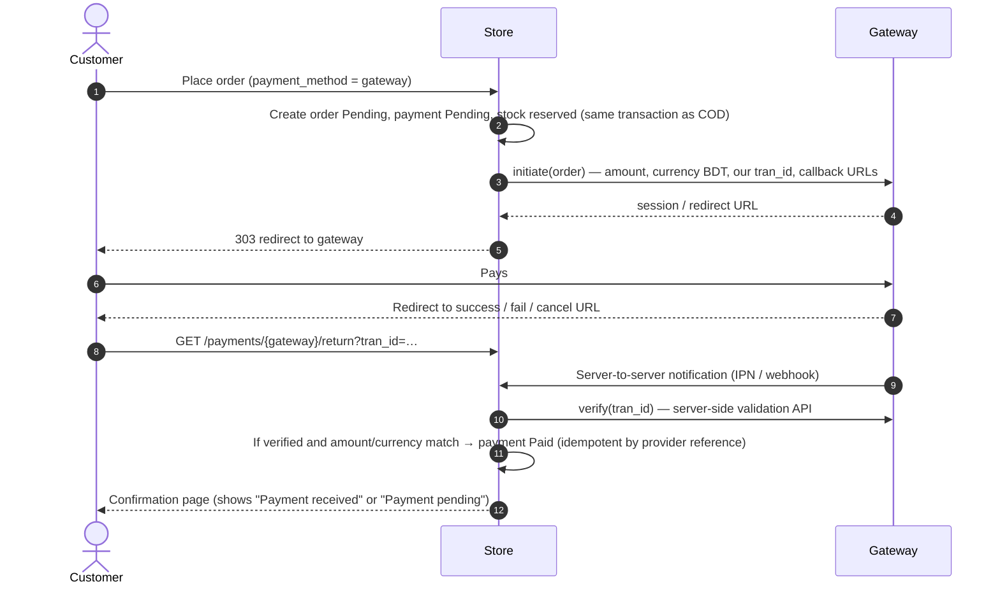

# DOC-09 — API & Integration Specification

| Field | Value |
|---|---|
| Project | Modern E-Commerce Website (Bangladesh) — working name **[Store Name]** |
| Document ID | DOC-09 |
| Version | 0.1 (Draft) |
| Date | 2026-10-13 |
| Prepared by | Claude (acting Solution Architect) |
| Depends on | DOC-02 SRS v0.2, DOC-05 SAD v0.1 |
| Status | Draft — awaiting review |

---

## 1. Purpose and scope

This document specifies:

1. The **internal HTTP endpoints** the storefront and admin pages call (JSON, session-authenticated). These are the only APIs in the MVP (ADR-012).
2. The **checkout submission contract**, including idempotency.
3. **Integration contracts** for future payment gateways, couriers and SMS — interfaces, flows, webhook validation and retry rules — so they can be added without changing the order flow.

Nothing in §6–§8 is active in the MVP. Vendor-specific details (endpoints, field names, signature algorithms) must be taken from each provider's current official documentation and sandbox at implementation time; this document defines only our side of the contract.

## 2. Conventions

| Item | Rule |
|---|---|
| Base URL | Same origin as the site, e.g. `https://[domain]` |
| Transport | HTTPS only; HSTS enabled |
| Format | `Content-Type: application/json; charset=utf-8` for JSON endpoints; HTML form posts for full-page flows (checkout, login) |
| Request headers (JSON) | `Accept: application/json`, `X-CSRF-TOKEN: <token from meta tag>`, `X-Requested-With: XMLHttpRequest` |
| Money | Strings with two decimals in BDT, e.g. `"2790.00"`, plus a `formatted` field, e.g. `"৳2,790"` — never floats |
| Dates | ISO 8601 in UTC (`2026-10-13T07:30:00Z`); UI converts to Asia/Dhaka |
| IDs | Numeric IDs only for the caller's own resources; orders exposed by `order_number` |
| Pagination | `?page=N`; response `meta: {current_page, last_page, per_page, total}` |
| Versioning | Internal endpoints are unversioned (same release as the pages that call them). Public API, if built, is `/api/v1` (§10) |

### 2.1 Response envelope

Success:

```json
{
  "data": { "...": "..." },
  "message": "Optional human-readable message"
}
```

Validation error (HTTP 422) — Laravel's standard shape:

```json
{
  "message": "The quantity may not be greater than 4.",
  "errors": {
    "quantity": ["Only 4 available for this colour."]
  }
}
```

Other errors:

```json
{
  "message": "Too many attempts. Please try again in 45 seconds.",
  "code": "rate_limited"
}
```

### 2.2 Status codes

| Code | Use |
|---|---|
| 200 OK | Read or update succeeded |
| 201 Created | Resource created (cart item) |
| 204 No Content | Delete succeeded |
| 303 See Other | Successful form post redirects (checkout → confirmation) |
| 401 Unauthorized | Not logged in (JSON endpoints requiring a customer) |
| 403 Forbidden | Logged in but not permitted (admin permissions, review eligibility) |
| 404 Not Found | Resource missing **or belongs to someone else** (never reveal existence) |
| 409 Conflict | State conflict: invalid order transition, order changed by another staff member |
| 419 Page Expired | CSRF token missing/expired |
| 422 Unprocessable Content | Validation failed, or checkout data changed (stock, price, coupon) |
| 429 Too Many Requests | Rate limit exceeded; `Retry-After` header set |
| 500 / 503 | Server error / maintenance — generic message with reference ID only |

Error `code` values: `validation_failed`, `out_of_stock`, `price_changed`, `coupon_invalid`, `zone_unavailable`, `invalid_transition`, `rate_limited`, `not_found`, `forbidden`, `server_error`.

## 3. Authentication and authorisation

| Caller | Mechanism | Notes |
|---|---|---|
| Guest | Session cookie + guest cart token cookie (`cart_token`, 40 random chars, HttpOnly, Secure, SameSite=Lax, 30 days) | Cart endpoints work for guests |
| Customer | Session (`web` guard) | Account endpoints require auth; policies enforce ownership |
| Staff | Session (`admin` guard) + permission middleware (`permission:<name>`) | Admin JSON endpoints also check policies |
| External systems (future) | Webhook signature/credential validation (§9); never session | Routes under `/webhooks/*`, excluded from CSRF only |

All state-changing requests require a valid CSRF token, except webhooks.

## 4. Rate limiting

Implemented with Laravel named rate limiters (`RateLimiter::for`). Keys combine IP and an identity where available.

| Limiter | Applies to | Limit (initial, configurable) | Key |
|---|---|---|---|
| `login` | Customer login | 5 / minute | email-or-phone + IP |
| `admin-login` | Staff login | 5 / minute; 20 / hour | email + IP |
| `password-reset` | Reset link requests | 3 / 15 minutes | email + IP |
| `register` | Registration | 5 / hour | IP |
| `cart` | Cart JSON endpoints | 60 / minute | session |
| `coupon` | Coupon check | 10 / minute | session + IP |
| `checkout` | Place order | 5 / 10 minutes per IP; 5 / hour per phone | IP; normalised phone |
| `track-order` | Guest tracking | 6 / minute | IP |
| `search` | Search page and suggestions | 60 / minute | IP |
| `contact` | Contact form | 5 / hour | IP |
| `geo` | District/area lookups | 120 / minute | IP |

## 5. Internal endpoint inventory

### 5.1 Summary

| # | Method | Path | Auth | Purpose | SRS |
|---|---|---|---|---|---|
| E-01 | GET | `/cart` (JSON when `Accept: application/json`) | Guest/Customer | Current cart with priced lines and notices | FR-CRT-001/004/006 |
| E-02 | POST | `/cart/items` | Guest/Customer | Add variant to cart | FR-CRT-001/003 |
| E-03 | PATCH | `/cart/items/{item}` | Guest/Customer (owner) | Change quantity | FR-CRT-001/003 |
| E-04 | DELETE | `/cart/items/{item}` | Guest/Customer (owner) | Remove line | FR-CRT-001 |
| E-05 | GET | `/product/{slug}/variants` | Public | Variant matrix: options, price, stock state, SKU, image | FR-STF-006 |
| E-06 | GET | `/geo/divisions/{division}/districts` | Public | Districts of a division | FR-CHK-002 |
| E-07 | GET | `/geo/districts/{district}/areas` | Public | Areas of a district | FR-CHK-002 |
| E-08 | POST | `/checkout/quote` | Guest/Customer | Recalculate summary for district + coupon (no side effects) | FR-CHK-003/004/005 |
| E-09 | POST | `/checkout` (form) | Guest/Customer | Place order (idempotent) | FR-CHK-007/008 |
| E-10 | GET | `/search/suggest?q=` | Public | Up to 6 product suggestions | FR-SRC-006 |
| E-11 | POST | `/account/wishlist/{product}` / DELETE same | Customer | Toggle wishlist | FR-WSH-001 |
| E-12 | POST | `/track-order` (form) | Guest | Look up order by number + phone | FR-ACC-008 |
| E-13 | POST | `/admin/orders/{order}/status` | Staff `orders.update-status` / `orders.cancel` | Change order status | FR-ORD-002 |
| E-14 | POST | `/admin/orders/{order}/payments` | Staff `orders.payments` | Record COD collection | FR-PAY-003 |
| E-15 | POST | `/admin/inventory/{variant}/adjustments` | Staff `inventory.adjust` | Stock adjustment | FR-INV-005 |
| E-16 | POST | `/admin/products/{product}/images` | Staff `products.edit` | Upload image (multipart) | FR-CAT-007/008 |

Non-JS fallback: E-02 to E-04, E-08, E-11 also accept normal form posts and redirect back with flash messages, so core flows work without JavaScript.

### 5.2 Cart

**E-02 `POST /cart/items`**

Request:

```json
{ "variant_id": 1042, "quantity": 2 }
```

| Field | Rules |
|---|---|
| `variant_id` | required, integer, exists, variant active and product active |
| `quantity` | required, integer, 1 … min(stock, per-line max − quantity already in cart) |

Response `201`:

```json
{
  "data": {
    "item": { "id": 77, "variant_id": 1042, "quantity": 2 },
    "cart": {
      "count": 3,
      "subtotal": { "amount": "7530.00", "formatted": "৳7,530" }
    }
  },
  "message": "Added to cart"
}
```

Errors: `422 out_of_stock` (with available quantity in `errors.quantity`), `404` (inactive/unknown variant), `429`.

**E-03 `PATCH /cart/items/{item}`** — body `{ "quantity": 3 }`; `quantity: 0` is rejected (use DELETE). Returns the updated cart (E-01 shape). `404` if the item is not in the caller's cart.

**E-01 cart shape:**

```json
{
  "data": {
    "lines": [
      {
        "id": 77,
        "product": { "name": "Wireless Earbuds Pro", "slug": "wireless-earbuds-pro", "image": "/storage/p/…/card.webp" },
        "variant": { "id": 1042, "label": "Black", "sku": "EBP-BLK" },
        "quantity": 2,
        "unit_price": { "amount": "2790.00", "formatted": "৳2,790" },
        "line_total": { "amount": "5580.00", "formatted": "৳5,580" },
        "available": true,
        "notices": [ { "type": "price_changed", "message": "Price changed from ৳2,590 to ৳2,790" } ]
      }
    ],
    "count": 2,
    "subtotal": { "amount": "5580.00", "formatted": "৳5,580" },
    "checkout_allowed": true
  }
}
```

`notices[].type`: `price_changed`, `quantity_reduced`, `out_of_stock`, `unavailable`.

### 5.3 Product variants

**E-05 `GET /product/{slug}/variants`** — cached per product (invalidated on change).

```json
{
  "data": {
    "options": [
      { "type": "Colour", "style": "swatch", "values": [
        { "id": 3, "value": "Black", "swatch": "#1F2328" },
        { "id": 4, "value": "White", "swatch": "#F4F6F8" }
      ] }
    ],
    "variants": [
      { "id": 1042, "option_value_ids": [3], "sku": "EBP-BLK",
        "price": { "amount": "2790.00", "formatted": "৳2,790" },
        "compare_at": { "amount": "3490.00", "formatted": "৳3,490" },
        "stock_state": "in_stock", "max_quantity": 10, "image_id": 551 },
      { "id": 1043, "option_value_ids": [4], "sku": "EBP-WHT",
        "price": { "amount": "2790.00", "formatted": "৳2,790" },
        "compare_at": null,
        "stock_state": "low", "low_stock_count": 4, "max_quantity": 4, "image_id": 552 }
    ]
  }
}
```

`stock_state`: `in_stock`, `low` (with `low_stock_count`), `out_of_stock`. Exact stock is not exposed unless low (business choice, prevents competitor scraping). `compare_at` is null unless greater than price.

### 5.4 Geography

**E-06** response: `{ "data": [ { "id": 1, "name": "Dhaka", "name_bn": "ঢাকা", "deliverable": true } ] }`. **E-07** same shape for areas plus `"other_allowed": true`.

### 5.5 Checkout quote (no side effects)

**E-08 `POST /checkout/quote`**

```json
{ "district_id": 1, "area_id": 12, "coupon_code": "WELCOME10", "phone": "01712345678" }
```

Response `200`:

```json
{
  "data": {
    "zone": { "name": "Inside Dhaka", "estimate": "1–2 days", "deliverable": true },
    "subtotal": { "amount": "4740.00", "formatted": "৳4,740" },
    "discount": { "amount": "474.00", "formatted": "৳474" },
    "delivery_charge": { "amount": "60.00", "formatted": "৳60" },
    "total": { "amount": "4326.00", "formatted": "৳4,326" },
    "coupon": { "code": "WELCOME10", "status": "applied", "message": "You save ৳474" }
  }
}
```

`coupon.status`: `applied`, `rejected` (with reason: `expired`, `not_started`, `inactive`, `min_not_met`, `not_applicable`, `limit_reached`, `customer_limit_reached`, `unknown`). `phone` is optional and only used for the per-customer limit. The quote is advisory; E-09 recalculates everything.

### 5.6 Place order (idempotent)

**E-09 `POST /checkout`** — HTML form post (`application/x-www-form-urlencoded`).

| Field | Rules |
|---|---|
| `_token` | CSRF token |
| `checkout_token` | required; 40-char token issued when the checkout page rendered; bound to session and cart; expires after 2 h |
| `name` | VR-01 |
| `phone` | VR-02 (normalised) |
| `email` | VR-03 (optional for guests) |
| `address_id` | optional (customer); must belong to the customer |
| `division_id`, `district_id`, `area_id`, `area_text`, `address_line`, `postcode`, `instructions` | VR-05 (required unless `address_id` given) |
| `coupon_code` | optional, VR-07 |
| `payment_method` | required, one of enabled methods (`cod`) |
| `expected_total` | the total the shopper saw; used only to detect change, never to charge |
| `save_address` | optional boolean (customer) |

Server behaviour (DOC-05 §6.1):

1. Validate input.
2. If `checkout_token` is already used → `303` to that order's confirmation.
3. In one transaction: lock variants and coupon, recalculate, compare with cart and `expected_total`, create order, deduct stock, record coupon, mark token used.
4. On success → `303 See Other` to `/order/{number}/thank-you` (signed for guests).
5. On change → redirect back to checkout with `422`-style flash containing `code` (`out_of_stock`, `price_changed`, `coupon_invalid`, `zone_unavailable`) and the refreshed summary; no order is created.

**Idempotency guarantees:** one token creates at most one order (unique constraint on `checkout_tokens.token` and `order_id`); retries after network failure are safe; a new token is issued every time the checkout page renders.

### 5.7 Admin: order status

**E-13 `POST /admin/orders/{order}/status`**

```json
{ "to": "shipped", "expected_from": "processing", "note": "Handed to courier",
  "courier_name": "[Courier]", "tracking_reference": "ABC123", "reason": null }
```

| Field | Rules |
|---|---|
| `to` | required; one of the order statuses |
| `expected_from` | required; current status as displayed; mismatch → `409` (someone else changed it) |
| `reason` | required when `to` is `cancelled` or `returned` |
| `courier_name`, `tracking_reference` | optional; only with `shipped` |

Responses: `200` with updated order summary and allowed next statuses; `409 invalid_transition` with `allowed: [...]`; `403` without permission. Returns use a dedicated form (`/admin/orders/{order}/returns`) because they carry per-line data.

**E-14 `POST /admin/orders/{order}/payments`** — `{ "amount": "4326.00", "collected_at": "2026-10-14T10:00:00Z", "variance_reason": null }`; `variance_reason` required if amount ≠ outstanding total. **E-15** — `{ "type": "restock|adjustment|correction", "quantity": -3, "reason": "Damaged in storage" }`; result below zero → `422`.

## 6. Payment gateway integration contract (future — FS-01)

### 6.1 Interface (our side)

Defined in DOC-05 §9: `PaymentGateway` with `code()`, `isAvailableFor(Order)`, `initiate(Order)`, `handleCallback(Request)`, `verify(Payment)`, `supportsRefund()`, `refund(Payment, amount)`. `CashOnDelivery` is the only implementation in the MVP.

### 6.2 Redirect-based gateway flow (e.g. SSLCommerz-type, bKash/Nagad checkout-type)



Rules:

- **Never trust the browser return.** Payment becomes Paid only after server-side verification (gateway validation API and/or verified IPN), and only if `amount`, `currency` and our `tran_id` match the order.
- `tran_id` = our payment UUID; stored in `payments.provider_reference` after the gateway returns its own transaction ID (unique index → duplicate notifications are no-ops).
- **Unpaid timeout:** gateway orders not paid within a configurable window (default 30 min) are auto-cancelled by a scheduled job, restoring stock and coupon (same `OrderStatusService` path).
- Payment failure leaves the order Pending with payment Failed and offers "Try again" or "Switch to Cash on Delivery" (if eligible).
- Refunds via `refund()` only for gateways that support API refunds; otherwise recorded manually (FR-ORD-010).
- Credentials (store ID, password, app key/secret) in `.env` only; sandbox and live keys never mixed; live mode toggle restricted to Super Admin.
- Stored `provider_payload` is sanitised: no card numbers, no wallet PINs, no OTPs.

### 6.3 Gateway onboarding checklist

1. Merchant account and sandbox credentials from the provider.
2. Read current official API docs; record endpoint versions and signature/validation method in an ADR.
3. Implement class + config + settings form; feature flag off.
4. Contract tests with recorded sandbox responses (success, fail, cancel, duplicate IPN, amount mismatch, late IPN after timeout cancel).
5. Staging end-to-end test in sandbox; security review of callback routes.
6. Business approval → enable in production.

## 7. Courier integration contract (future — FS-02)

Interface `CourierProvider`: `createShipment(Order): ShipmentResult`, `track(reference): TrackingResult`, `cancel(reference): bool`, plus optional `webhook(Request): TrackingEvent[]`.

| Our field | Meaning |
|---|---|
| `merchant_order_id` | Our `order_number` (idempotency key at the courier) |
| `recipient_name`, `recipient_phone`, `address`, `district`, `area` | From the order snapshot |
| `cod_amount` | Order outstanding amount (0 for prepaid) |
| `item_description`, `weight_grams`, `quantity` | From order items |
| `instructions` | Delivery instructions |

Status mapping (courier → ours) maintained per provider in config, e.g. `picked_up → Shipped`, `delivered → Delivered`, `returned / cancelled_by_recipient → Returned` (return still requires staff inspection before restock, BR-07). Courier events never move an order backwards and are applied through `OrderStatusService` so all rules and audit apply. COD settlement reports from couriers can be imported later to mark payments Paid.

Candidate providers (to be confirmed by the business): local courier services with merchant APIs commonly used in Bangladesh. Selection, contracts and API versions are decided when FS-02 is approved.

## 8. Notifications and SMS contract

**MVP (email):** Laravel notifications/mailables, queued on the `database` queue, dispatched after commit.

| Event | Recipient | Template | Toggle |
|---|---|---|---|
| `OrderPlaced` | Customer (if email) | `emails.orders.placed` | Always on |
| `OrderPlaced` | Staff address | `emails.orders.new-staff` | Settings |
| `OrderStatusChanged` → confirmed / shipped / delivered / cancelled | Customer (if email) | `emails.orders.status` | Per status |
| Password reset, email verification | Customer | Framework | Always on |
| Low-stock digest (S) | Inventory staff | `emails.inventory.low-stock` | Settings |

Retry: 3 attempts with backoff 1 min / 5 min / 15 min; then `failed_jobs`, surfaced on the dashboard. Jobs are idempotent (a sent-flag per notification and order prevents duplicates on retry).

**Future (SMS, FS-03):** `SmsSender::send(phone, message): SmsResult` behind a Laravel notification channel `sms`. Messages ≤ 160 GSM-7 characters or ≤ 70 Unicode (Bangla) characters per segment; templates stored in translation files; sender ID and API credentials in `.env`; per-phone throttling (e.g. 5 SMS/hour) to prevent abuse and cost spikes; delivery reports via webhook (§9). OTP login, if approved, will add its own rate limits and expiry rules.

## 9. Webhook handling (all future providers)

| Concern | Rule |
|---|---|
| Route | `POST /webhooks/{provider}` — outside CSRF, inside rate limiter (300/min per provider), separate log channel |
| Authenticity | Validate per provider: signature header (HMAC with shared secret, constant-time compare), credential echo, or validation-API call back to the provider; optionally IP allow-list. Unverified → `401`, logged, no processing |
| Replay protection | Reject events older than a tolerance window when a timestamp is provided; store provider event ID in `webhook_events` (UQ `provider`, `event_id`) — duplicates return `200` without reprocessing |
| Processing | Persist raw event (sanitised) → respond `200` quickly → process in a queued job. Never do slow work inside the request |
| Ordering | Apply events through domain services, which ignore transitions that are not allowed (e.g. late "paid" after a cancellation flags the order for staff review instead of reopening it) |
| Failure & retry | Job retries 5 times with exponential backoff (1, 5, 15, 60, 240 min); after final failure the event is marked `failed` and shown in admin System health. Providers' own retries are absorbed by the duplicate check |
| Reconciliation | Daily job queries the provider for payments/shipments still in non-final states older than X hours and reconciles |

Table to add when the first webhook integration is built: `webhook_events` (id, provider, event_id, type, payload JSON sanitised, received_at, processed_at, status, attempts, error).

## 10. Public API outline (future — FS-08)

If mobile apps are approved: `/api/v1` with Laravel Sanctum personal access tokens for customers, API Resources mirroring the JSON shapes above, the same domain services and policies, cursor pagination, and per-token rate limits. An OpenAPI 3.1 file (`docs/api/openapi-v1.yaml`) will be the authoritative contract and will be generated and tested in CI. No public API endpoints are exposed in the MVP.

## Change log

| Version | Date | Author | Change |
|---|---|---|---|
| 0.1 | 2026-10-13 | Claude | Initial draft |
